[Actividad 1.1 U_1.md](https://github.com/user-attachments/files/34227494/Actividad.1.1.U_1.md)
Materia: Fundamentos Bases de Datos Actividades U.1 – Tareas 1.1 Maestro: Rubén Miguel Riojas Rodríguez Semestre: 5to Semestre Alumno: José Luis Luna García

Matricula: I24050385

## Tarea 1.1: Fundamentos, objetivos y modelos de bases de datos

Mapa conceptual sobre los conceptos fundamentales, objetivos, usos y aplicaciones de las bases de datos

```mermaid
flowchart TD
    root["<b>Base de datos"]

    %% Categorías Principales 
    root --> A["<b>APLICACIONES"]
    root --> B["<b>CONCEPTOS FUNDAMENTALES"]
    root --> C["<b>OBJETIVOS"]
    root --> D["<b>USOS"]

    %% Aplicaciones 
    A --> A1["<b>Comercio Electrónico (E-commerce):</b><br />Control de inventario, gestión de catálogos,<br />carritos de compra y procesamiento de pagos."]
    A --> A2["<b>Hotelería y Servicios:</b><br />Registro de reservaciones diarias, gestión<br />de clientes y servicios."]
    A --> A3["<b>Banca y Finanzas:</b><br />Manejo de cuentas bancarias, transacciones,<br />pasarelas de pago e historiales de crédito."]
    A --> A4["<b>Gestión Empresarial (ERP y CRM):</b><br />Administración integral de recursos internos<br />de la empresa y relaciones con clientes."]
    A --> A5["<b>Entornos Cloud e Inteligencia Artificial:</b><br />Aplicación en infraestructuras híbridas,<br />búsqueda semántica y asistentes inteligentes."]

    %% Conceptos Fundamentales 
    B --> B1["<b>Dato:</b><br />Unidad básica y mínima de información<br />que por sí sola carece de contexto."]
    B --> B2["<b>Información / Metadatos:</b><br />Conjunto de datos procesados con significado.<br />Incluyen metadatos de estructura y relaciones."]
    B --> B3["<b>Campos:</b><br />Columnas de una tabla que definen el tipo<br />específico de información guardada."]
    B --> B4["<b>Registros:</b><br />Filas de una tabla que representan una<br />entrada única de datos interrelacionados."]
    B --> B5["<b>Tabla (Relación):</b><br />Componente principal donde se almacenan y<br />estructuran los datos en filas y columnas."]
    B --> B6["<b>Base de Datos (BD):</b><br />Colección organizada de datos estructurados<br />guardados de forma persistente."]
    B --> B7["<b>DBMS / SGBD:</b><br />Software interfaz (MySQL, PostgreSQL, Oracle,<br />SQL Server) para administrar datos."]
    B --> B8["<b>Operaciones CRUD:</b><br />Las 4 acciones básicas: Consultar (obtener),<br />Agregar (insertar), Eliminar y Actualizar."]
    B --> B9["<b>Redundancia:</b><br />Duplicación de datos en distintos archivos,<br />que los SGBD buscan controlar."]

    %% Objetivos 
    C --> C1["<b>Acceso rápido y ágil:</b><br />Facilitar la búsqueda y obtención veloz<br />de la información almacenada."]
    C --> C2["<b>Control de la redundancia:</b><br />Minimizar la duplicidad para ahorrar<br />espacio de almacenamiento en disco."]
    C --> C3["<b>Garantizar la consistencia:</b><br />Asegurar que los cambios se reflejen de<br />inmediato para todos los usuarios."]
    C --> C4["<b>Mejorar la integridad de los datos:</b><br />Aplicar reglas y restricciones para validar<br />que la información sea exacta."]
    C --> C5["<b>Proteger los datos (Seguridad):</b><br />Evitar accesos no autorizados mediante<br />niveles y permisos de acceso."]
    C --> C6["<b>Evitar la pérdida de información:</b><br />Garantizar la persistencia frente a fallos<br />(Concurrencia y Respaldos)."]
    C --> C7["<b>Garantizar la independencia:</b><br />Mantener los datos independientes de<br />las aplicaciones que los utilizan."]
    C --> C8["<b>Mantenimiento de estándares:</b><br />Facilitar el cumplimiento de normativas<br />de formato a nivel empresarial e internacional."]

    %% Usos 
    D --> D1["<b>Centralización de la información:</b><br />Reunir los datos de distintas áreas en una<br />única infraestructura compartida."]
    D --> D2["<b>Compartición de datos (Acceso concurrente):</b><br />Permitir que múltiples usuarios autorizados<br />accedan simultáneamente."]
    D --> D3["<b>Trazabilidad y auditoría:</b><br />Mantener registros históricos (logs) y copias<br />de seguridad de las operaciones."]
    D --> D4["<b>Uso transaccional:</b><br />Manejar transacciones diarias garantizando<br />fiabilidad (propiedades ACID)."]
    D --> D5["<b>Uso analítico y Business Intelligence:</b><br />Extraer patrones y alimentar cuadros de mando<br />(Data Warehousing)."]
    D --> D6["<b>Casos modernos (IA y Cloud):</b><br />Entrenar modelos de Machine Learning e IA<br />generativa (bases de datos vectoriales)."]
```

*(infranet, s.f.) (epitech, s.f.) (immune, s.f.) (studocudocument, s.f.) (godaddy, s.f.)*

## Distintos modelos de bases de datos

| Modelo de Base de Datos | Definición | Estructura representacional de Datos |
| --- | --- | --- |
| Modelo de relación | Ordena la información en tablas de dos dimensiones vinculadas mediante relaciones. Garantiza la consistencia e integridad de los datos a través de reglas estandarizadas. | Tablas (Relaciones): Compuestas por filas (tuplas) y columnas (campos/atributos). Se representan vínculos utilizando claves primarias (𝑃𝐾) y claves externas/foráneas (𝐹𝐾). |
| Modelo Jerárquico | Organiza la información en una estructura que asemeja un árbol invertido, donde cada registro tiene un nodo raíz del que se desprenden ramas. Cada nodo hijo tiene un único nodo padre. | Estructura de Árbol / Nodos Padre- Hijo: Mantiene relaciones estrictas de uno a muchos (1: 𝑁). El recorrido de los datos se realiza ordenadamente desde la raíz hacia los nodos hojas. |
| Modelo en Red | Evolución del modelo jerárquico que permite relaciones más complejas de uno a muchos y de muchos a muchos entre registros vinculados, admitiendo nodos principales múltiples. | Conjuntos y Grafos: Punteros directos que conectan registros propietarios (principales) con registros miembros (secundarios), permitiendo que un nodo hijo tenga múltiples padres. |
| Modelo Plano (Flat File) | Estructura bidimensional sencilla (precursora del modelo relacional) en la que todos los registros se almacenan en un único archivo sin relaciones externas ni enlaces interconectados. | Matriz o Archivo de Texto: Una sola tabla/archivo donde los elementos de la misma columna comparten el mismo tipo de dato y las filas representan entradas de datos relacionadas por delimitadores (ej. CSV, TXT). |
| Modelo Orientado a Objetos | Colección de objetos utilizados en la programación orientada a objetos (C++, Java, etc.), almacenando información detallada integrando características y comportamiento. | Objetos y Clases: Estructuras que encapsulan estado (atributos/campos) y operaciones (métodos/mensajes), soportando abstracción, herencia y polimorfismo. |
| Modelo Relacional de Objetos | Modelo híbrido que combina la estructura del modelo relacional con las capacidades del modelo | Tablas extendidas con Objetos: Filas convencionales que pueden albergar tipos de datos definidos por el usuario, arreglos anidados, clases, |

|   | orientado a objetos para admitir estructuras más complejas y escalables. | relaciones de herencia y referencias a objetos. |
| --- | --- | --- |
| Modelo Entidad- Relación (E-R) | Diagrama conceptual y paso previo al modelo relacional. Se elabora para identificar los elementos clave del mundo real que se representarán en el sistema y cómo se vinculan. | Diagrama conceptual E-R: • Entidades: Rectángulos. • Atributos: Óvalos (con clave distintiva). • Relaciones: Rombos. • Cardinalidad: Conexiones 1: 1, 1: N o N: M. |
| Modelo de Archivo Invertido | Diseñado como una tabla de consulta para búsquedas rápidas, donde los elementos almacenados sirven como claves de índice que apuntan a la ubicación exacta de los datos. | Índices y Punteros: Listas indexadas donde cada término clave o palabra contiene referencias y punteros directos hacia la posición de los documentos o registros fuente. |
| Modelo Multidimensional | Diseñado para aplicaciones de procesamiento analítico en línea (OLAP), permitiendo extraer y consolidar métricas de negocios rápidamente desde múltiples perspectivas. | Cubos de Datos: Celdas interconectadas donde los ejes representan dimensiones (ej. tiempo, región, producto) y el contenido interior equivale al valor numérico de la métrica o hecho. |
| Modelo Semiestructurado | Se aplica a datos que no se ajustan al formato rígido de tablas, filas y columnas. Organiza la información mediante etiquetas que crean jerarquías sin separar el dato de su esquema. | Árboles Jerárquicos con Marcadores: Estructuras flexibles basadas en etiquetas y pares clave- valor donde el esquema está embebido junto a los propios datos (ej. JSON, XML, YAML). |
| Modelo de Contexto | Arquitectura flexible que incorpora elementos de varios modelos (orientado a objetos, semiestructurados y en red) para adaptar y recuperar datos según el estado o entorno del sistema. | Grafos y Redes de Metadatos: Redes interconectadas de entidades y asociaciones enriquecidas con atributos contextuales (roles de usuario, ubicación, tiempos y estados). |
| Modelo Asociativo | Divide toda la información en dos grupos independientes: entidades y asociaciones, permitiendo registrar datos sin necesidad de diseñar | Elementos y Enlaces: • Elementos: Poseen ID único, nombre y tipo. • Enlaces: Registran tripletas (Fuente - Verbo - Objeto) compuestas por los identificadores de los elementos. |

|   | esquemas de tablas prefijadas. |   |
| --- | --- | --- |
| Modelos NoSQL | Conjunto diverso de modelos no relacionales diseñados para alta disponibilidad, escalabilidad horizontal y gestión de grandes volúmenes de datos no estructurados o Big Data. | Formatos Varios: • Documental: Documentos JSON/BSON. • Clave-Valor: Diccionarios directos. • Grafos: Nodos, aristas y propiedades. • Multivalor / Columnas: Familias de columnas. |

*(godaddy, s.f.) (descubreradius, s.f.) (ayudaleypro, s.f.) (arsys, s.f.)*

## Referencias

arsys. (s.f.). Obtenido de https://www.arsys.es/blog/tipos-de-bases-de-datos-que-

existen

ayudaleypro. (s.f.). Obtenido de https://ayudaleyprotecciondatos.es/bases-de-

datos/modelos/

descubreradius. (s.f.). Obtenido de https://descubreradius.com/blog/modelos-de-

base-de-datos

epitech. (s.f.). Obtenido de https://www.epitech-it.es/base-de-datos/

godaddy. (s.f.). Obtenido de https://www.godaddy.com/resources/latam/stories/que-

es-una-base-de-datos

immune. (s.f.). Obtenido de https://immune.institute/blog/base-de-datos-que-es-

usos/

infranet. (s.f.). Obtenido de https://blog.infranetworking.com/objetivos-base-de-

datos/

studocudocument. (s.f.). Obtenido de https://www.studocu.com/es-

mx/document/universidad-tecnologica-de-tabasco/base-de- datos/introduccion-a-las-bases-de- datos/32573382?sid=%24device%3A19345b4ab241471-0c14e610f2a36c-46524258-144000-19345b4ab2414711787798340
