[Actividad 1.2 U_1 Fundamento Base de datos.md]

Materia: Fundamentos Bases de Datos Actividades U.1 – Tareas 1.2 Maestro: Rubén Miguel Riojas Rodríguez Semestre: 5to Semestre Alumno: José Luis Luna García Matricula: I24050385 

### Contenido 

| Contenido  |  |
| --- | ---: |
| [**Tarea 1.2: Clasificación y arquitecturas (ANSI/SPARC y SGBD)**](#tarea-12-clasificación-y-arquitecturas-ansisparc-y-sgbd) | [3](#tarea-12-clasificación-y-arquitecturas-ansisparc-y-sgbd) |
| [Cuadro sinóptico sobre la clasificación de las bases de datos](#cuadro-sinóptico-sobre-la-clasificación-de-las-bases-de-datos) | [3](#cuadro-sinóptico-sobre-la-clasificación-de-las-bases-de-datos) |
| [Arquitectura de base de datos y del sistema gestor de base de datos con base en los diagramas de arquitectura](#arquitectura-de-base-de-datos-y-del-sistema-gestor-de-base-de-datos-con-base-en-los-diagramas-de-arquitectura) | [6](#arquitectura-de-base-de-datos-y-del-sistema-gestor-de-base-de-datos-con-base-en-los-diagramas-de-arquitectura) |
| [Referencias](#referencias) | [10](#referencias) |

# Tarea 1.2: Clasificación y arquitecturas (ANSI/SPARC y SGBD) 

## Cuadro sinóptico sobre la clasificación de las bases de datos 

```mermaid
flowchart LR
    %% Nodo Principal Raíz
    ROOT["<b>BASES DE DATOS</b>"]

    %% ==========================================
    %% RAMA 1: SEGÚN EL CONTENIDO (1.png)
    %% ==========================================
    ROOT --> C1["<b>Según el contenido</b>"]

    C1 --> C1_1["<b>Bibliográficas</b><br /><i>Base de datos orientada a la catalogación mediante metadatos de publicaciones o eventos.</i>"]
    C1_1 --> C1_1_CAR["<b>Características:</b><br />• Contiene solo campos descriptivos (autor, título, fecha).<br />• No almacena el texto completo."]

    C1 --> C1_2["<b>De Texto Completo</b><br /><i>Repositorio digital diseñado para albergar documentos o fuentes primarias en su totalidad.</i>"]
    C1_2 --> C1_2_CAR["<b>Características:</b><br />• Soporta búsquedas avanzadas por palabras clave dentro del contenido íntegro.<br />• Uso científico."]

    C1 --> C1_3["<b>Directorios</b><br /><i>Registro estructurado destinado a la organización de datos de contacto e identificación.</i>"]
    C1_3 --> C1_3_CAR["<b>Características:</b><br />• Contiene campos básicos (nombres, teléfonos, correos).<br />• De consulta frecuente empresarial."]

    %% ==========================================
    %% RAMA 2: SEGÚN SU UBICACIÓN (2.png)
    %% ==========================================
    ROOT --> C2["<b>Según su ubicación</b>"]

    C2 --> C2_1["<b>Centralizadas</b><br /><i>Los datos se almacenan en un único sitio o servidor físico al que acceden los usuarios.</i>"]
    C2_1 --> C2_1_CAR["<b>Características:</b><br />• Punto único de fallo: si el servidor cae, todo el sistema colapsa.<br />• Escalabilidad vertical (ampliar recursos de la máquina).<br />• Administración simple: control directo y centralizado."]

    C2 --> C2_2["<b>Distribuidas</b><br /><i>Los datos se almacenan en múltiples computadoras o nodos interconectados en red.</i>"]
    C2_2 --> C2_2_CAR["<b>Características:</b><br />• Tolerancia a fallos: si un nodo cae, los demás continúan operando.<br />• Escalabilidad horizontal (añadir más nodos a la red).<br />• Transparencia: oculta la complejidad al usuario final."]

    %% ==========================================
    %% RAMA 3: SEGÚN LA VARIABILIDAD (3.png)
    %% ==========================================
    ROOT --> C3["<b>Según la variabilidad</b>"]

    C3 --> C3_1["<b>Estáticas</b><br /><i>Sistema de almacenamiento acumulativo proyectado exclusivamente para consulta histórica.</i>"]
    C3_1 --> C3_1_CAR["<b>Características:</b><br />• Operaciones de solo lectura (Read-Only).<br />• No admite modificaciones.<br />• Base para analítica."]

    C3 --> C3_2["<b>Dinámicas</b><br /><i>Sistema de almacenamiento operativo sujeto a alteraciones continuas de la información.</i>"]
    C3_2 --> C3_2_CAR["<b>Características:</b><br />• Soporta operaciones CRUD (Crear, Leer, Modificar, Eliminar).<br />• Actualización en tiempo real."]

    C3 --> C3_3["<b>In-Memory</b><br /><i>Base de datos cuyo motor de almacenamiento reside directamente en la memoria RAM.</i>"]
    C3_3 --> C3_3_CAR["<b>Características:</b><br />• Tiempos de respuesta extremadamente bajos (latencia mínima).<br />• Volatilidad de datos sin persistencia."]

    %% ==========================================
    %% RAMA 4: SEGÚN ADMINISTRACIÓN DE DATOS (4.png y 5.png)
    %% ==========================================
    ROOT --> C4["<b>Según Administración<br />de Datos</b>"]

    %% Bloque 4.png
    C4 --> C4_1["<b>Jerárquicas</b><br /><i>Organiza la información en una estructura en forma de árbol invertido.</i>"]
    C4_1 --> C4_1_CAR["<b>Características:</b><br />• Nodos organizados en niveles (Raíz, Padre, Hijo).<br />• Relación estricta 1:N (un hijo solo tiene un padre).<br />• Rigidez estructural."]

    C4 --> C4_2["<b>De Red</b><br /><i>Evolución del modelo jerárquico que permite interconexiones múltiples entre registros.</i>"]
    C4_2 --> C4_2_CAR["<b>Características:</b><br />• Relaciones N:M (un nodo hijo puede tener varios padres).<br />• Reduce redundancia; alta complejidad de diseño."]

    C4 --> C4_3["<b>Relacionales (SQL)</b><br /><i>Organiza la información en tablas compuestas por filas y columnas vinculadas entre sí.</i>"]
    C4_3 --> C4_3_CAR["<b>Características:</b><br />• Uso del lenguaje estándar SQL.<br />• Claves primarias y foráneas.<br />• Cumplimiento estricto de consistencia (ACID)."]

    C4 --> C4_4["<b>Transaccionales</b><br /><i>Motor optimizado para recolección, procesamiento y envío acelerado de datos.</i>"]
    C4_4 --> C4_4_CAR["<b>Características:</b><br />• Alta velocidad de ejecución.<br />• Priorización de transferencias sin pérdida.<br />• Uso bancario e industrial."]

    %% Bloque 5.png
    C4 --> C4_5["<b>Multidimensionales</b><br /><i>Variantes del modelo relacional estructuradas en cubos de datos para análisis complejo.</i>"]
    C4_5 --> C4_5_CAR["<b>Características:</b><br />• Organización en dimensiones y métricas.<br />• Base para procesamiento analítico en línea (OLAP)."]

    C4 --> C4_6["<b>Orientadas a Objetos</b><br /><i>Almacena entidades completas encapsulando su estado y comportamiento.</i>"]
    C4_6 --> C4_6_CAR["<b>Características:</b><br />• Integración directa con lenguajes POO.<br />• Evita el mapeo objeto-relacional.<br />• Admite estructuras complejas."]

    C4 --> C4_7["<b>Documentales (NoSQL)</b><br /><i>Base de datos no relacional que utiliza documentos independientes como unidad.</i>"]
    C4_7 --> C4_7_CAR["<b>Características:</b><br />• Formatos semiestructurados (JSON, BSON, XML).<br />• Esquema flexible (Schemaless).<br />• Alta escalabilidad horizontal."]

    C4 --> C4_8["<b>Deductivas (Lógicas)</b><br /><i>Fundada en la lógica matemática capaz de aplicar inferencias sobre la información guardada.</i>"]
    C4_8 --> C4_8_CAR["<b>Características:</b><br />• Utiliza el lenguaje Datalog.<br />• Aplica reglas y hechos.<br />• Permite derivar nueva información implícita."]

    %% ==========================================
    %% ESTILOS VISUALES PROFESIONALES
    %% ==========================================
    classDef rootStyle fill:#1A365D,stroke:#0F172A,stroke-width:2.5px,color:#FFFFFF,font-size:16px,font-weight:bold;
    classDef catStyle fill:#2B6CB0,stroke:#1A365D,stroke-width:2px,color:#FFFFFF,font-size:14px,font-weight:bold;
    classDef typeStyle fill:#EDF2F7,stroke:#4A5568,stroke-width:1.5px,color:#1A202C,font-size:12px;
    classDef charStyle fill:#FFFFFF,stroke:#CBD5E1,stroke-width:1px,color:#334155,font-size:11px,text-align:left;

    class ROOT rootStyle;
    class C1,C2,C3,C4 catStyle;
    class C1_1,C1_2,C1_3,C2_1,C2_2,C3_1,C3_2,C3_3,C4_1,C4_2,C4_3,C4_4,C4_5,C4_6,C4_7,C4_8 typeStyle;
    class C1_1_CAR,C1_2_CAR,C1_3_CAR,C2_1_CAR,C2_2_CAR,C3_1_CAR,C3_2_CAR,C3_3_CAR,C4_1_CAR,C4_2_CAR,C4_3_CAR,C4_4_CAR,C4_5_CAR,C4_6_CAR,C4_7_CAR,C4_8_CAR charStyle;
```

(hostingplus, s.f.) (graphevery, s.f.) 

## Arquitectura de base de datos y del sistema gestor de base de datos con base en los diagramas de arquitectura 

En el diseño y la gestión de sistemas de información modernos, la arquitectura de las bases de datos y de sus Sistemas Gestores (SGBD) constituye un pilar fundamental para garantizar el rendimiento, la seguridad y la independencia de la información. Un SGBD no es simplemente un repositorio de datos, sino una plataforma de software compleja encargada de interpretar consultas, gestionar transacciones, controlar accesos y administrar el almacenamiento físico en disco. 

Para comprender y documentar de manera rigurosa este funcionamiento, la teoría clásica de bases de datos —basada en estándares como el modelo de tres niveles ANSI/SPARC y la literatura fundamental de ciencia de la computación— se puede representar mediante el Lenguaje de Modelado Unificado (UML). A través de tres diagramas estructurales clave, es posible analizar la arquitectura desde sus tres dimensiones esenciales: 

- **Diagrama de Paquetes:** Describe la arquitectura lógica y la organización por niveles de abstracción (externo, conceptual e interno) para garantizar la independencia lógica y física de los datos. 
- **Diagrama de Componentes:** Representa la estructura interna del software del SGBD, desglosando sus módulos funcionales principales (Procesador de Consultas y Gestor de Almacenamiento). 
- **Diagrama de Despliegue:** Muestra la infraestructura física, ilustrando la interacción entre los nodos de usuario, el servidor donde ejecuta el motor y los artefactos de almacenamiento persistente en disco (archivos de datos, catálogo e índices). 

1. **Arquitectura Lógica de la Base de Datos (Diagrama de Paquetes)** 

El diagrama de paquetes en UML agrupa y organiza los elementos lógicos del sistema. En el ámbito de las bases de datos, este diagrama representa la arquitectura de tres niveles (ANSI/SPARC), cuya finalidad es aislar las aplicaciones de usuario de los detalles físicos de almacenamiento. 

Paquete: Nivel Externo (Vistas de Usuario) 

 (Mapping / Transformación) 

Paquete: Nivel Conceptual (Esquema Global) 

 (Mapping / Transformación) 

Paquete: Nivel Interno (Esquema Físico) 

    - **Paquete de Nivel Externo (Vistas):** Contiene los esquemas externos. Cada paquete define la vista parcial de la base de datos relevante para un grupo específico de usuarios, ocultando la información irrelevante o restringida. 
    - **Paquete de Nivel Conceptual:** Modela la estructura global de la base de datos para toda la organización. Agrupa entidades, atributos, relaciones y reglas de negocio, manteniendo una representación abstracta sin detalles físicos. 
    - **Paquete de Nivel Interno (Físico):** Contiene el esquema interno que especifica cómo se organizan las estructuras de datos, las rutas de acceso y los registros en los medios de almacenamiento. 

**Independencia de Datos:** Esta división en paquetes habilita la _independencia lógica_ (modificar el esquema conceptual sin alterar las aplicaciones) y la _independencia física_ (modificar estructuras internas de disco sin alterar el esquema conceptual). 

2. **Arquitectura Modular del SGBD (Diagrama de Componentes)** 

El diagrama de componentes describe la estructura interna del SGBD considerado como un sistema de software, detallando los módulos que procesan las peticiones y administran la información. 

COMPONENTE: PROCESADOR DE CONSULTAS 

    - Intérprete de DDL 
    - Compilador / Traductor de DML 
    - Motor de Evaluación de Consultas 

COMPONENTE: GESTOR DE ALMACENAMIENTO 

    - Gestor de Autorización e Integridad 
    - Gestor de Transacciones (Control ACID) 
    - Gestor de Archivos 
    - Gestor de Memoria Intermedia (Buffer Manager) 

- **Procesador de Consultas:** Encargado de transformar las peticiones expresadas en lenguajes de alto nivel a instrucciones de bajo nivel. 

        1. Intérprete de DDL: Procesa las sentencias de definición de datos y actualiza el diccionario del sistema. 

        1. Compilador de DML: Traduce las consultas (como instrucciones SQL) en planes de ejecución optimizados. 

        1. Motor de Evaluación: Ejecuta las instrucciones de bajo nivel generadas por el compilador. 

- **Gestor de Almacenamiento:** Módulo que sirve de interfaz entre las consultas y el almacenamiento físico. 

        1. Gestor de Memoria Intermedia (Buffer Manager): Optimiza el uso de memoria RAM manteniendo en caché los bloques de datos más frecuentados. 

        1. Gestor de Transacciones: Garantiza el cumplimiento de las propiedades **ACID** (Atomicidad, Consistencia, Aislamiento y Durabilidad). 

        1. Gestor de Archivos y Autorización: Administra la asignación de espacio en disco y valida los permisos de acceso de los usuarios. 

3. **Arquitectura de Infraestructura y Almacenamiento (Diagrama de Despliegue)** 

El diagrama de despliegue modela la topología de hardware, mostrando cómo los componentes de software y los archivos de datos se distribuyen en nodos físicos o virtuales. 

    - **Nodos Cliente (\<\<device\>\>):** Representan las estaciones de trabajo o dispositivos finales desde donde los distintos tipos de usuarios (usuarios finales, programadores y administradores DBA) envían solicitudes al sistema. 
    - **Nodo Servidor (\<\<executionEnvironment\>\>):** Representa la infraestructura donde ejecuta el motor del SGBD (Procesador de Consultas y Gestor de Almacenamiento). 
    - **Artefactos en Disco (\<\<artifact\>\>):** Representan los archivos persistentes almacenados en los medios físicos gestionados por el nodo servidor: 

            1. Archivos de Datos: Registros reales de la base de datos. 

            1. Diccionario de Datos (Catálogo): Metadatos con la estructura, esquemas y restricciones del sistema. 

            1. Índices: Estructuras físicas auxiliares para optimizar la velocidad de búsqueda. 

**Conclusión** 

La representación de la arquitectura de una base de datos y de su SGBD mediante diagramas UML permite tender un puente claro entre la teoría clásica de bases de datos y la práctica de la ingeniería de software. 

Mientras que el Diagrama de Paquetes formaliza la abstracción lógica en tres niveles garantizando la independencia de los datos, el Diagrama de Componentes desglosa la complejidad del motor de software en módulos especializados para el procesamiento de consultas y el control de transacciones. Por su parte, el Diagrama de Despliegue aterriza estos conceptos en el mundo físico, mostrando la distribución en hardware y los archivos persistentes en disco. Comprender la integración de estas tres vistas es esencial para diseñar, implementar y mantener sistemas de bases de datos robustos, escalables y eficientes. 

(es.scribd, s.f.) (studocu, s.f.) 

# Referencias 

_es.scribd_. (s.f.). Obtenido de https://es.scribd.com/document/633683714/ARQUITECTURA-BASE-DE-DATOS-Y-SGBD 

_graphevery_. (s.f.). Obtenido de https://www.grapheverywhere.com/tipos-bases-de-datos-clasificacion/ 

_hostingplus_. (s.f.). Obtenido de https://www.hostingplus.mx/blog/clasificacion-de-las-bases-de-datos-conoce-todos-los-tipos/ 

_studocu_. (s.f.). Obtenido de https://www.studocu.com/es-mx/document/instituto-tecnologico-de-orizaba/base-de-datos/arquitectura-de-un- sistema/28001759?sid=%24device%3A19345b4ab241471-0c14e610f2a36c- 46524258-144000-19345b4ab2414711787865198 
