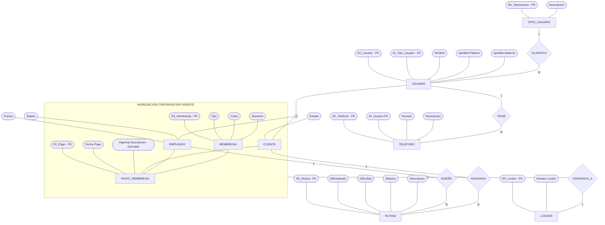
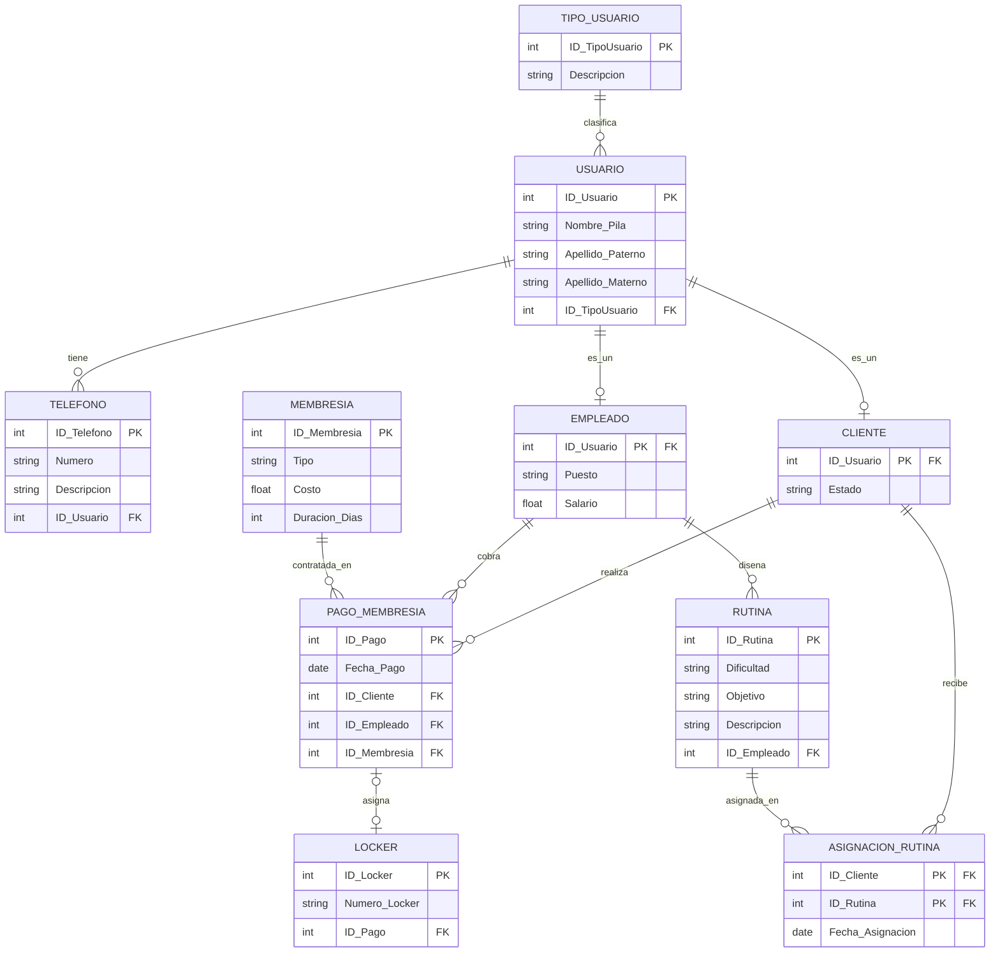

[Actividad 3..1 U_3 Fundamentos Base de datos.md]
Materia: Fundamentos Bases de Datos Actividades U.3 – Tareas 3.1 Maestro: Rubén Miguel Riojas Rodríguez Semestre: 5to Semestre Alumno: José Luis Luna García Matricula: I24050385 

### Contenido 

| Contenido  |  |
| --- | ---: |
| [**Unidad 3 - Tareas 3.1**](#unidad-3---tareas-31) | [3](#unidad-3---tareas-31) |
| [Tarea 1- Componentes formales del modelo relacional y las restricciones de integridad](#tarea-1--componentes-formales-del-modelo-relacional-y-las-restricciones-de-integridad) | [3](#tarea-1--componentes-formales-del-modelo-relacional-y-las-restricciones-de-integridad) |
| [Introducción](#introducción) | [3](#introducción) |
| [¿Qué es una Base de Datos Relacional?](#qué-es-una-base-de-datos-relacional) | [3](#qué-es-una-base-de-datos-relacional) |
| [Componentes Principales del Modelo Relacional](#componentes-principales-del-modelo-relacional) | [3](#componentes-principales-del-modelo-relacional) |
| [Ejemplo Práctico de Conexión entre Tablas](#ejemplo-práctico-de-conexión-entre-tablas) | [5](#ejemplo-práctico-de-conexión-entre-tablas) |
| [Reglas de Diseño e Integridad del Modelo Relacional](#reglas-de-diseño-e-integridad-del-modelo-relacional) | [5](#reglas-de-diseño-e-integridad-del-modelo-relacional) |
| [Ventajas Principales del Modelo Relacional](#ventajas-principales-del-modelo-relacional) | [6](#ventajas-principales-del-modelo-relacional) |
| [Conclusión](#conclusión) | [6](#conclusión) |
| [Tarea 2 – Transforma el diagrama E-R del proyecto de la Unidad 2 a un esquema relacional](#tarea-2--transforma-el-diagrama-e-r-del-proyecto-de-la-unidad-2-a-un-esquema-relacional) | [7](#tarea-2--transforma-el-diagrama-e-r-del-proyecto-de-la-unidad-2-a-un-esquema-relacional) |
| [Introducción y Contexto del Caso de Estudio](#introducción-y-contexto-del-caso-de-estudio) | [7](#introducción-y-contexto-del-caso-de-estudio) |
| [El Modelo Entidad-Relación Extendido (EER) Original](#el-modelo-entidad-relación-extendido-eer-original) | [8](#el-modelo-entidad-relación-extendido-eer-original) |
| [Pilares Conceptuales del Modelo EER](#pilares-conceptuales-del-modelo-eer) | [9](#pilares-conceptuales-del-modelo-eer) |
| [Reglas Formales de Transformación de EER a Esquema Relacional](#reglas-formales-de-transformación-de-eer-a-esquema-relacional) | [10](#reglas-formales-de-transformación-de-eer-a-esquema-relacional) |
| [El Esquema Relacional Lógico Resultante](#el-esquema-relacional-lógico-resultante) | [12](#el-esquema-relacional-lógico-resultante) |
| [Definición Formal de Relaciones (Esquema Textual)](#definición-formal-de-relaciones-esquema-textual) | [13](#definición-formal-de-relaciones-esquema-textual) |
| [Matriz Comparativa de Correspondencia Directa](#matriz-comparativa-de-correspondencia-directa) | [14](#matriz-comparativa-de-correspondencia-directa) |
| [Implementación Física en SQL Estándar (Script DDL)](#implementación-física-en-sql-estándar-script-ddl) | [15](#implementación-física-en-sql-estándar-script-ddl) |
| [Conclusiones y Beneficios del Esquema Relacional](#conclusiones-y-beneficios-del-esquema-relacional) | [18](#conclusiones-y-beneficios-del-esquema-relacional) |
| [Bibliografía](#bibliografía) | [19](#bibliografía) |

# Unidad 3 - Tareas 3.1 

# Tarea 1- Componentes formales del modelo relacional y las restricciones de integridad 

## Introducción 

En la era digital, la gestión eficiente y organizada de la información es fundamental para cualquier sistema informático. Las bases de datos relacionales constituyen la columna vertebral del almacenamiento de datos estructurados en la mayoría de las organizaciones y aplicaciones modernas. 

El objetivo de este reporte es presentar de manera clara, accesible y exhaustiva los componentes formales que integran una base de datos relacional (relaciones, atributos, tuplas y dominios), la forma en que se interconectan las estructuras de datos y las reglas esenciales de diseño e integridad (entidad, referencial y de dominio) que garantizan la precisión, solidez y consistencia de la información. 

## ¿Qué es una Base de Datos Relacional? 

Una base de datos relacional es una forma de organizar e interconectar información estructurada. Fue ideada por E. F. Codd en IBM en la década de 1970 y se basa en la idea formal de almacenar datos en tablas interconectadas compuestas por filas y columnas. 

Una analogía sencilla es imaginar un libro de contabilidad o un conjunto de hojas de cálculo interconectadas, donde cada «hoja» guarda un tipo particular de datos sobre un tema u objeto y se relaciona dinámicamente con las demás a través de elementos en común. 

## Componentes Principales del Modelo Relacional 

Para comprender la estructura de una base de datos relacional, es necesario conocer sus bloques de construcción formales: 

1. **Tablas (Relaciones)** 

Una tabla o relación es una estructura bidimensional en cuadrícula que agrupa datos estructurados sobre una entidad o tema específico (por ejemplo, Clientes, Productos o Pedidos). Cada relación representa un conjunto formal de datos interrelacionados. 

1. **Columnas (Atributos)** 

Las columnas o atributos representan las categorías individuales de información o propiedades que se desean registrar sobre cada elemento de la tabla. Cada atributo tiene asociado un nombre unívoco y guarda un tipo de dato específico. 

1. **Filas (Registros o Tuplas)** 

Cada fila en una tabla representa una tupla o registro individual. Constituye una instancia única que contiene los valores concretos correspondientes a cada uno de los atributos definidos en la tabla para esa entidad particular. 

1. **Claves (Keys)** 

Las claves son atributos especiales que permiten identificar registros de manera unívoca y establecer conexiones entre diferentes tablas: 

    - **Clave Primaria (Primary Key):** Es el identificador único e irrepetible de cada fila en una tabla. No pueden existir dos filas con la misma clave primaria y su valor jamás puede ser nulo (por ejemplo, el número de ID\_Cliente). 
    - **Clave Foránea o Externa (Foreign Key):** Es un atributo en una tabla que hace referencia directa a la clave primaria de otra tabla, estableciendo formalmente la relación entre ambas. 

1. **Dominios (Componente Formal)** 

Un dominio es el conjunto formal de todos los valores escalares y atómicos válidos que puede tomar un determinado atributo (columna). Define los límites conceptuales del dato permitido. 

    - **Tipo de dato y rango:** Especifica la naturaleza del dato (como números enteros, texto, fechas o listas discretas de valores como \['Activo', 'Inactivo'\]). 
    - **Atomicidad:** Todos los elementos pertenecientes a un dominio son indivisibles e irremplazables por colecciones de valores. 
    - **Homogeneidad:** Garantiza que todos los valores almacenados en la misma columna compartan la misma estructura y significado semántico. 

## Ejemplo Práctico de Conexión entre Tablas 

Supongamos que una tienda en línea necesita administrar clientes y sus compras mediante dos tablas relacionadas: 

| **Tabla**  | **Atributos / Columnas**  | **Función de Clave**  |
| --- | --- | --- |
| Clientes  | ID\_Cliente, Nombre, Dirección  | ID\_Cliente actúa como Clave Primaria (PK)  |
| Pedidos  | ID\_Pedido, ID\_Cliente, Fecha  | ID\_Pedido es Clave Primaria (PK) ID\_Cliente es Clave Foránea (FK)  |
| Relación  | Conecta Pedidos -\> Clientes  | ID\_Cliente en Pedidos hace referencia a ID\_Cliente en Clientes  |

Al incluir el campo ID\_Cliente en la tabla Pedidos, el sistema permite conocer exactamente qué persona realizó cada compra sin necesidad de duplicar su nombre 

1. dirección en cada transacción. 

## Reglas de Diseño e Integridad del Modelo Relacional 

Para garantizar que la información se mantenga precisa, coherente y libre de anomalías, el modelo relacional impone principios fundamentales de integridad y normalización: 

1. **Regla de Atomicidad:** Cada celda (intersección entre fila y columna) debe contener un solo valor atómico indivisible. 
2. **Regla de Integridad de Entidad:** Cada tabla debe contar obligatoriamente con una clave primaria definida. Ningún componente de la clave primaria puede ser nulo (NOT NULL) ni duplicado, asegurando la identificación unívoca de cada tupla. 
3. **Regla de Integridad Referencial:** Si una tabla contiene una clave foránea que referencia a otra tabla, todo valor de esa clave foránea debe existir previamente en la clave primaria de la tabla origen (o ser nulo si la relación es opcional). 
4. **Regla de Integridad de Dominio:** Exige que todo valor ingresado, actualizado o almacenado en un atributo pertenezca estrictamente al dominio predefinido para dicho atributo. 

Mecanismos y controles de la Integridad de Dominio: 

- **Validación de Tipo:** Impide registrar datos de tipo incompatible (por ejemplo, texto en celdas numéricas o fechas imposibles). 
- **Restricción NOT NULL:** Determina si el atributo requiere obligatoriamente un valor o si admite ausencia de datos. 
- **Cláusulas de Validación (CHECK):** Cláusulas condicionales que imponen límites numéricos o de rango (por ejemplo, CHECK (Edad \>= 18)). 

**Normalización y Eliminación de Redundancias:** Proceso de estructuración que organiza las tablas para eliminar duplicaciones innecesarias, optimizar el espacio y evitar inconsistencias durante operaciones de inserción, actualización o borrado. 

## Ventajas Principales del Modelo Relacional 

- **Flexibilidad y Escalabilidad:** Permite añadir o modificar tablas y relaciones sin alterar la estructura general de la base de datos. 
- **Integridad y Seguridad:** Garantiza la consistencia y validez de la información mediante el cumplimiento de las propiedades ACID (Atomicidad, Consistencia, Aislamiento y Durabilidad). 
- **Consultas Potentes (SQL):** Facilita la extracción rápida y estructurada de datos cruzando múltiples tablas mediante el lenguaje estándar SQL. 

## Conclusión 

El modelo relacional destaca por su simplicidad conceptual y su rigurosa solidez formal. Al organizar los datos en relaciones (tablas) interconectadas por claves primarias y foráneas, permite representar cualquier escenario del mundo real con claridad y precisión. 

El cumplimiento estricto de sus restricciones de integridad —entidad, referencial y de dominio— junto con las reglas de atomicidad y normalización, elimina la duplicación innecesaria y asegura la validez de los datos a lo largo del tiempo. Con la inclusión explícita del concepto de dominio y su correspondiente restricción de integridad, este documento completa de forma exhaustiva los componentes formales del modelo relacional exigidos académicamente. 

(cloud, s.f.) (databricks, s.f.) (docs, s.f.) (stucdocu, s.f.) 

# Tarea 2 – Transforma el diagrama E-R del proyecto de la Unidad 2 a un esquema relacional 

## Introducción y Contexto del Caso de Estudio 

En esta tarea se expone de manera sistemática y rigurosa la evolución metodológica del diseño de base de datos para la gestión operativa y administrativa de un centro deportivo (gimnasio). En fases conceptuales previas, se identificaron severas deficiencias originadas por el uso de métodos manuales y hojas de cálculo no sincronizadas: pérdida de trazabilidad en los cobros de membresías, asignación arbitraria de casilleros a clientes sin suscripción vigente, duplicidad en el registro de usuarios y descontrol en la programación de rutinas de entrenamiento. 

Para subsanar esta problemática, se formuló un Modelo Entidad-Relación Extendido (EER) con capacidad para abstraer jerarquías de herencia, relaciones multivaloradas y mecanismos avanzados de agregación. No obstante, para implementar físicamente dicho diseño en un Sistema Gestor de Bases de Datos Relacionales (SGBD) comercial (como PostgreSQL, MySQL o SQL Server), resulta indispensable aplicar un proceso formal de transformación hacia el Modelo Relacional. Este proceso traduce entidades, atributos compuestos, generalizaciones y agregaciones en tablas en Tercera Forma Normal (3FN), garantizando la integridad referencial y la eficiencia computacional. 

## El Modelo Entidad-Relación Extendido (EER) Original 

El Modelo Entidad-Relación Extendido (EER) constituye la representación conceptual de alto nivel que captura directamente los requerimientos del negocio sin depender de restricciones físicas de almacenamiento. 

## Pilares Conceptuales del Modelo EER 

El modelo conceptual EER destaca por la integración de tres construcciones avanzadas esenciales para reflejar fielmente la operativa deportiva: 

**Jerarquía de Especialización Disjunta (d):** La entidad USUARIO actúa como superclase contenedora de los datos personales generales. De ella se desprenden las subclases CLIENTE y EMPLEADO bajo una regla disjunta (d), lo que significa que un usuario no puede asumir simultáneamente ambos roles en este diseño. Ambas subclases heredan implícitamente la clave primaria y atributos generales, manteniendo únicamente sus atributos particulares (Estado para cliente; Puesto y Salario para empleado). 

**Estructura de Atributos Especiales:** Se modela el atributo Nombre como un atributo compuesto (desglosado en Nombre de Pila, Apellido Paterno y Apellido Materno). Para los teléfonos de contacto, se formula una entidad dependiente de atributo multivalorado (TELEFONO) para almacenar cero, uno o múltiples números por persona sin incurrir en campos repetidos. 

**Mecanismo de Agregación (CONTRATACIÓN VIGENTE):** La regla de negocio más crítica establece que un casillero (LOCKER) no se asigna al cliente por el simple hecho de estar registrado, sino exclusivamente cuando existe una transacción activa de cobro. En lugar de forzar una relación directa y desarticulada entre CLIENTE y LOCKER, la relación ternaria PAGO\_MEMBRESIA (que asocia al socio, al empleado cobrador y al tipo de membresía) se encapsula mediante un bloque de agregación, conectando el casillero directamente a la contratación activa. Asimismo, la vigencia del servicio se establece como un atributo derivado calculado a partir de la fecha de pago y los días de duración del plan. 

## Reglas Formales de Transformación de EER a Esquema Relacional 

La conversión de un modelo conceptual EER a un esquema lógico relacional no es arbitraria; sigue algoritmos fundamentados en el álgebra relacional y la teoría de normalización de Codd. A continuación se detallan las reglas específicas aplicadas a cada constructo del gimnasio: 

**Regla 1: Mapeo de Entidades Fuertes y Aplanamiento de Atributos Compuestos** 

Cada entidad regular se traduce en una relación (tabla) independiente. Sus atributos simples pasan a ser columnas directas. Por exigencia de la Primera Forma Normal (1FN), los atributos compuestos no se pueden almacenar como campos complejos estructurados; se aplanan descomponiéndose en atributos atómicos. Así, el atributo NOMBRE de USUARIO se traduce en Nombre\_Pila, Apellido\_Paterno y Apellido\_Materno. 

**Regla 2: Mapeo de Especialización/Generalización Disjunta (Herencia)** 

Para una especialización disjunta con atributos propios y asociaciones específicas por rol, la técnica estándar recomendada consiste en generar una tabla para la superclase (USUARIO) y una tabla separada para cada subclase (CLIENTE y EMPLEADO). La clave primaria de la superclase (ID\_Usuario) se propaga hacia cada subclase, actuando simultáneamente como Clave Primaria (PK) y Clave Foránea (FK). Esto garantiza integridad referencial absoluta sin inventar IDs artificiales redundantes. 

**Regla 3: Mapeo de Atributos Multivalorados** 

Para preservar la 1FN y evitar grupos repetitivos, los atributos multivalorados deben aislarse en una tabla propia. Se crea la tabla TELEFONO, la cual adopta como clave foránea el identificador ID\_Usuario referenciando a USUARIO, vinculándose bajo una política de borrado en cascada (ON DELETE CASCADE). 

**Regla 4: Mapeo de Relaciones Binarias 1:N** 

En toda relación uno a muchos, la clave primaria de la entidad con cardinalidad 1 se propaga como clave foránea (FK) hacia la tabla del lado N. Esto se aplica en TIPO\_USUARIO (1) -\> USUARIO (N), donde ID\_TipoUsuario se inserta en USUARIO; y en EMPLEADO (1) -\> RUTINA (N), donde ID\_Empleado se propaga a RUTINA. 

**Regla 5: Mapeo de Relaciones Ternarias y Transacciones (Agregación)** 

Una relación n-aria que formaliza una transacción de cobro genera una tabla relacional independiente. PAGO\_MEMBRESIA se estructura con una clave primaria propia (ID\_Pago) y tres llaves foráneas obligatorias (NOT NULL): ID\_Cliente (FK), ID\_Empleado (FK) e ID\_Membresia (FK). 

**Regla 6: Tratamiento de Atributos Derivados** 

Por normas de normalización (evitar anomalías de actualización y redundancia), los atributos derivados no se almacenan como columnas estáticas en la base de datos relacional. Por ende, Vigencia\_Suscripcion no se crea como columna física; se calcula dinámicamente mediante consultas o vistas sumando Duracion\_Dias a la Fecha\_Pago. 

**Regla 7: Mapeo de Relaciones 1:1 Opcionales con Agregación (Casillero)** 

Para vincular el casillero a la contratación activa, la clave primaria de la agregación (ID\_Pago) se propaga como clave foránea hacia la tabla LOCKER. Para cumplir la regla de que un casillero solo puede tener máximo una membresía activa a la vez, se establece una restricción de unicidad (UNIQUE) sobre ID\_Pago, permitiendo valores NULL cuando el casillero se encuentre desocupado. 

**Regla 8: Mapeo de Relaciones Muchos a Muchos (N:M)** 

La asociación de plantillas de entrenamiento hacia socios (CLIENTE y RUTINA) no puede resolverse mediante propagación simple sin generar redundancias masivas. Se crea una tabla asociativa intermedia denominada ASIGNACION\_RUTINA, cuya clave primaria es compuesta: (ID\_Cliente, ID\_Rutina), siendo ambos campos llaves foráneas simultáneas. 

**CRITERIO TÉCNICO DE HERENCIA RELACIONAL:** La propagación de la llave ID\_Usuario como PK y FK en CLIENTE y EMPLEADO preserva de forma pura la jerarquía de herencia sin añadir llaves sustitutas artificiales. Esta decisión asegura que cualquier consulta sobre un cliente o empleado pueda unirse directamente con la tabla USUARIO sin traducciones intermedias. 

## El Esquema Relacional Lógico Resultante 

Como resultado de la aplicación estricta de las reglas de conversión anteriores, el modelo conceptual EER se transforma en el Esquema Relacional de Tablas estructurado bajo notación pata de gallo (crow's foot) 

## Definición Formal de Relaciones (Esquema Textual) 

A continuación se presenta el esquema lógico formal donde las Llaves Primarias (PK) se destacan en negrita subrayada y las Llaves Foráneas (FK) se indican con su respectiva referencia de integridad: 

- **TIPO\_USUARIO:** (ID\_TipoUsuario \[PK\], Descripcion) 
- **USUARIO:** (ID\_Usuario \[PK\], Nombre\_Pila, Apellido\_Paterno, Apellido\_Materno, ID\_TipoUsuario \[FK -\> TIPO\_USUARIO.ID\_TipoUsuario\]) 
- **TELEFONO:** (ID\_Telefono \[PK\], Numero, Descripcion, ID\_Usuario \[FK -\> USUARIO.ID\_Usuario\]) 
- **CLIENTE:** (ID\_Usuario \[PK, FK -\> USUARIO.ID\_Usuario\], Estado) 
- **EMPLEADO:** (ID\_Usuario \[PK, FK -\> USUARIO.ID\_Usuario\], Puesto, Salario) 
- **MEMBRESIA:** (ID\_Membresia \[PK\], Tipo, Costo, Duracion\_Dias) 
- **PAGO\_MEMBRESIA:** (ID\_Pago \[PK\], Fecha\_Pago, ID\_Cliente \[FK -\> CLIENTE.ID\_Usuario\], ID\_Empleado \[FK -\> EMPLEADO.ID\_Usuario\], ID\_Membresia \[FK -\> MEMBRESIA.ID\_Membresia\]) 
- **LOCKER:** (ID\_Locker \[PK\], Numero\_Locker, ID\_Pago \[FK -\> PAGO\_MEMBRESIA.ID\_Pago, UNIQUE, NULLABLE\]) 
- **RUTINA:** (ID\_Rutina \[PK\], Dificultad, Objetivo, Descripcion, ID\_Empleado \[FK -\> EMPLEADO.ID\_Usuario\]) 
- **ASIGNACION\_RUTINA:** (ID\_Cliente \[PK, FK -\> CLIENTE.ID\_Usuario\], ID\_Rutina \[PK, FK -\> RUTINA.ID\_Rutina\], Fecha\_Asignacion) 

## Matriz Comparativa de Correspondencia Directa 

La Tabla sintetiza la correspondencia uno a uno entre los elementos del Modelo EER conceptual y su implementación concreta en el Esquema Relacional, destacando el criterio técnico aplicado para garantizar normalización e integridad. 

| **Elemento Modelo EER**  | **Implementación Relacional**  | **Criterio Técnico y Regla de Negocio**  |
| --- | --- | --- |
| **Entidad Regular (USUARIO, MEMBRESIA, TIPO\_USUARIO)**  | Tabla independiente con Clave Primaria (PK)  | Cada entidad conceptual pasa a ser una tabla base donde cada tupla representa una instancia única identificada por su PK.  |
| **Atributo Compuesto (NOMBRE en USUARIO)**  | Aplanamiento en columnas atómicas (Nombre\_Pila, Apellido\_Paterno, Apellido\_Materno)  | Cumplimiento estricto de la Primera Forma Normal (1FN) al erradicar atributos multivalorados o compuestos en una misma celda.  |
| **Especialización Disjunta (d) (USUARIO -\> CLIENTE, EMPLEADO)**  | Tablas separadas con ID\_Usuario como PK y FK simultánea  | Mapeo de superclase y subclases. Se elimina la redundancia de datos personales comunes y se mantiene integridad referencial pura.  |
| **Atributo Multivalorado (TELEFONO)**  | Tabla independiente con ID\_Telefono (PK) e ID\_Usuario (FK)  | Garantiza que un usuario pueda tener 0, 1 o N teléfonos sin crear columnas artificiales fijas (telefono1, telefono2) ni listas.  |
| **Agregación CONTRATACIÓN VIGENTE (PAGO\_MEMBRESIA)**  | Tabla transaccional PAGO\_MEMBRESIA con ID\_Pago (PK) y 3 FKs obligatorias  | La relación ternaria formaliza el cobro uniendo al socio, al empleado cobrador y al tipo de membresía adquirido en una fecha dada.  |
| **Atributo Derivado (Vigencia\_Suscripcion)**  | No se almacena en tabla física (se calcula en consultas mediante Fecha\_Pago + Duracion\_Dias)  | Preserva la Tercera Forma Normal (3FN), evitando inconsistencias y redundancia de datos calculables en tiempo de ejecución.  |
| **Asignación de Casillero (LOCKER a Contratación)**  | Columna ID\_Pago (FK) con restricción UNIQUE en la tabla LOCKER  | Modela la cardinalidad 1:1 opcional: el casillero solo puede tener máximo una contratación activa asignada (o estar en NULL/libre).  |
| **Relación 1:N (EMPLEADO diseña RUTINA)**  | Propagación de ID\_Empleado (FK) en la tabla RUTINA  | La clave primaria del instructor responsable se propaga a la tabla dependiente de rutinas para asegurar autoría.  |
| **Relación N:M (CLIENTE asignado a RUTINA)**  | Tabla intermedia ASIGNACION\_RUTINA con PK compuesta (ID\_Cliente, ID\_Rutina)  | Permite que múltiples socios tengan la misma rutina y que un socio posea un historial de múltiples planes de ejercicio.  |

## Implementación Física en SQL Estándar (Script DDL) 

A continuación se presenta el código Data Definition Language (DDL) para materializar el esquema relacional en cualquier motor relacional compatible con el estándar ANSI SQL, incluyendo llaves primarias, foráneas, restricciones de no nulidad, unicidad y políticas de borrado: 

-- 1. Catálogo Tipo de Usuario CREATE TABLE TIPO\_USUARIO ( 

 ID\_TipoUsuario INT PRIMARY KEY, Descripcion VARCHAR(50) NOT NULL 

); 

-- 2. Superclase Usuario (Atributo Compuesto Aplanado en 1FN) CREATE TABLE USUARIO ( 

 ID\_Usuario INT PRIMARY KEY, Nombre\_Pila VARCHAR(50) NOT NULL, 

 Apellido\_Paterno VARCHAR(50) NOT NULL, Apellido\_Materno VARCHAR(50), 

 ID\_TipoUsuario INT NOT NULL, CONSTRAINT FK\_Usuario\_Tipo FOREIGN KEY (ID\_TipoUsuario) REFERENCES TIPO\_USUARIO(ID\_TipoUsuario) ); 

 -- 3. Atributo Multivalorado Teléfono (1:N) 

CREATE TABLE TELEFONO ( ID\_Telefono INT PRIMARY KEY, 

 Numero VARCHAR(20) NOT NULL, Descripcion VARCHAR(30), 

 ID\_Usuario INT NOT NULL, CONSTRAINT FK\_Telefono\_Usuario FOREIGN KEY (ID\_Usuario) REFERENCES USUARIO(ID\_Usuario) ON DELETE CASCADE ); 

 -- 4. Subclase Cliente (Herencia Disjunta: PK y FK simultánea) CREATE TABLE CLIENTE ( 

 ID\_Usuario INT PRIMARY KEY, Estado VARCHAR(20) NOT NULL DEFAULT 'Activo', CONSTRAINT FK\_Cliente\_Usuario FOREIGN KEY (ID\_Usuario) REFERENCES USUARIO(ID\_Usuario) ON DELETE CASCADE ); 

 -- 5. Subclase Empleado (Herencia Disjunta: PK y FK simultánea) CREATE TABLE EMPLEADO ( 

 ID\_Usuario INT PRIMARY KEY, Puesto VARCHAR(50) NOT NULL, 

 Salario DECIMAL(10, 2) NOT NULL CHECK (Salario \> 0), CONSTRAINT FK\_Empleado\_Usuario FOREIGN KEY (ID\_Usuario) REFERENCES USUARIO(ID\_Usuario) ON DELETE CASCADE ); 

 -- 6. Entidad Membresía 

CREATE TABLE MEMBRESIA ( ID\_Membresia INT PRIMARY KEY, 

 Tipo VARCHAR(50) NOT NULL, Costo DECIMAL(10, 2) NOT NULL CHECK (Costo \>= 0), Duracion\_Dias INT NOT NULL CHECK (Duracion\_Dias \> 0) ); 

 -- 7. Transacción de Cobro / Agregación Contratación Vigente CREATE TABLE PAGO\_MEMBRESIA ( 

 ID\_Pago INT PRIMARY KEY, Fecha\_Pago DATE NOT NULL, 

 ID\_Cliente INT NOT NULL, ID\_Empleado INT NOT NULL, 

 ID\_Membresia INT NOT NULL, CONSTRAINT FK\_Pago\_Cliente FOREIGN KEY (ID\_Cliente) REFERENCES CLIENTE(ID\_Usuario), 

 CONSTRAINT FK\_Pago\_Empleado FOREIGN KEY (ID\_Empleado) REFERENCES EMPLEADO(ID\_Usuario), 

 CONSTRAINT FK\_Pago\_Membresia FOREIGN KEY (ID\_Membresia) REFERENCES MEMBRESIA(ID\_Membresia) ); 

 -- 8. Asignación de Casillero (1:1 Opcional vinculada a la Transacción) CREATE TABLE LOCKER ( 

 ID\_Locker INT PRIMARY KEY, Numero\_Locker VARCHAR(10) NOT NULL UNIQUE, ID\_Pago INT UNIQUE, -- Restricción UNIQUE: máximo un casillero por pago activo 

 CONSTRAINT FK\_Locker\_Pago FOREIGN KEY (ID\_Pago) 

 REFERENCES PAGO\_MEMBRESIA(ID\_Pago) ON DELETE SET NULL ); 

 -- 9. Diseño de Rutinas (1:N desde Empleado) 

CREATE TABLE RUTINA ( ID\_Rutina INT PRIMARY KEY, 

 Dificultad VARCHAR(20) NOT NULL, Objetivo VARCHAR(100) NOT NULL, 

 Descripcion TEXT, ID\_Empleado INT NOT NULL, 

 CONSTRAINT FK\_Rutina\_Empleado FOREIGN KEY (ID\_Empleado) REFERENCES EMPLEADO(ID\_Usuario) 

); 

-- 10. Asignación de Rutinas a Clientes (Resolución N:M) CREATE TABLE ASIGNACION\_RUTINA ( 

 ID\_Cliente INT NOT NULL, ID\_Rutina INT NOT NULL, 

 Fecha\_Asignacion DATE DEFAULT CURRENT\_DATE, PRIMARY KEY (ID\_Cliente, ID\_Rutina), 

 CONSTRAINT FK\_Asig\_Cliente FOREIGN KEY (ID\_Cliente) REFERENCES CLIENTE(ID\_Usuario) ON DELETE CASCADE, CONSTRAINT FK\_Asig\_Rutina FOREIGN KEY (ID\_Rutina) REFERENCES RUTINA(ID\_Rutina) ON DELETE CASCADE ); 

## Conclusiones y Beneficios del Esquema Relacional 

La culminación de este proceso de transformación valida la solidez teórica y práctica del diseño de bases de datos relacionales para resolver problemas de gestión complejos. Los principales beneficios obtenidos son: 

**Eliminación Total de Redundancias (Normalización en 3FN):** Al descomponer los nombres compuestos, independizar los números de teléfono y evitar el almacenamiento redundante de atributos calculables (vigencia de membresía), el esquema minimiza el riesgo de inconsistencias durante inserciones, modificaciones y eliminaciones. 

**Preservación de la Integridad Referencial:** La propagación directa de ID\_Usuario en las subclases garantiza que ningún cliente o empleado pueda existir sin un registro de usuario previo, respetando la herencia sin sobrecargar el modelo con llaves sustitutas. 

**Blindaje de la Regla de Negocio para Casilleros:** La conexión entre LOCKER y PAGO\_MEMBRESIA mediante una llave foránea UNIQUE asegura que solo aquellos socios con una contratación formalmente activa y pagada puedan disfrutar de un casillero, impidiendo accesos no autorizados y asignaciones duplicadas. 

**Flexibilidad y Escalabilidad para Software Empresarial:** El esquema relacional resultante ofrece un punto de partida óptimo para ser mapeado mediante frameworks ORM (como Entity Framework, Hibernate o SQLAlchemy) en sistemas web y móviles modernos, manteniendo un alto rendimiento en consultas analíticas y transaccionales. 

# Bibliografía 

_cloud_. (s.f.). Obtenido de https://cloud.google.com/learn/what-is-a-relational-database?hl=es-419 

_databricks_. (s.f.). Obtenido de https://www-databricks-com.translate.goog/blog/what-is-a-relational-data-model?\_x\_tr\_sl=en&\_x\_tr\_tl=es&\_x\_tr\_hl=es&\_x\_tr\_pto=sge 

_docs_. (s.f.). Obtenido de https://docs-progress-com.translate.goog/bundle/openedge-database-introduction/page/Elements-of-a-relational-database.html?\_x\_tr\_sl=en&\_x\_tr\_tl=es&\_x\_tr\_hl=es&\_x\_tr\_pto=tc 

_stucdocu_. (s.f.). Obtenido de https://www.studocu.com/es-mx/document/universidad-salesiana/fundamentos-de-base-de-datos/reglas-de-diseno-de-base-de-datos-del-modelo-relacional/12380970?sid=%24device%3A19345b4ab241471-0c14e610f2a36c-46524258-144000-19345b4ab2414711788035323 
