[Actividad 4.1 U_4 Fundamentos Base de datos.md]

Materia: Fundamentos Bases de Datos Actividad U.4 – Tarea 4.1 Maestro: Rubén Miguel Riojas Rodríguez Semestre: 5to Semestre Alumno: José Luis Luna García Matricula: I24050385 

### Tabla de contenido 

| Tabla de contenido  |  |
| --- | ---: |
| [**Unidad 4 – Tarea 4.1**](#unidad-4--tarea-41) | [3](#unidad-4--tarea-41) |
| [Fundamentos de dependencias y mapa conceptual de formas normales](#fundamentos-de-dependencias-y-mapa-conceptual-de-formas-normales) | [3](#fundamentos-de-dependencias-y-mapa-conceptual-de-formas-normales) |
| [Concepto Formal y Objetivos de la Normalización de Bases de Datos](#concepto-formal-y-objetivos-de-la-normalización-de-bases-de-datos) | [3](#concepto-formal-y-objetivos-de-la-normalización-de-bases-de-datos) |
| [Teoría de Dependencias Funcionales y Notación Matemática](#teoría-de-dependencias-funcionales-y-notación-matemática) | [3](#teoría-de-dependencias-funcionales-y-notación-matemática) |
| [Las Anomalías Clásicas de Datos en Sistemas Relacionales](#las-anomalías-clásicas-de-datos-en-sistemas-relacionales) | [4](#las-anomalías-clásicas-de-datos-en-sistemas-relacionales) |
| [Síntesis y Reglas Jerárquicas de las Formas Normales (1FN a 5FN)](#síntesis-y-reglas-jerárquicas-de-las-formas-normales-1fn-a-5fn) | [6](#síntesis-y-reglas-jerárquicas-de-las-formas-normales-1fn-a-5fn) |
| [Mapa Conceptual del Proceso Integral de Normalización](#mapa-conceptual-del-proceso-integral-de-normalización) | [7](#mapa-conceptual-del-proceso-integral-de-normalización) |
| [Conclusiones y Consideraciones sobre Desnormalización Controlada](#conclusiones-y-consideraciones-sobre-desnormalización-controlada) | [8](#conclusiones-y-consideraciones-sobre-desnormalización-controlada) |
| [Referencias](#referencias) | [9](#referencias) |

# Unidad 4 – Tarea 4.1 

## Fundamentos de dependencias y mapa conceptual de formas normales 

### Concepto Formal y Objetivos de la Normalización de Bases de Datos 

La normalización de bases de datos es una técnica y metodología formal de diseño relacional, propuesta originalmente en la década de 1970 por el matemático e investigador de IBM Edgar F. Codd, cuyo propósito es organizar tablas, columnas y relaciones dentro de un sistema gestor relacional para minimizar sistemáticamente la redundancia de datos, garantizar la integridad lógica y prevenir la ocurrencia de inconsistencias y anomalías operativas. 

El principio medular de la teoría de la normalización establece que una estructura relacional no normalizada o con dependencias indeseables debe descomponerse en conjuntos de tablas más pequeños, cohesivos y estables, vinculados de forma determinista mediante llaves primarias (Primary Keys) y llaves foráneas (Foreign Keys). Este proceso se articula a través de un esquema de niveles jerárquicos acumulativos denominados Formas Normales (FN). Cada forma normal sucesiva impone restricciones matemáticas más estrictas sobre la estructura de atributos y dependencias, requiriendo de forma obligatoria haber satisfecho a plenitud las condiciones de los niveles precedentes. 

### Teoría de Dependencias Funcionales y Notación Matemática 

Una dependencia funcional describe una restricción de integridad estructural entre conjuntos de atributos dentro de una relación R. Formalmente, si X e Y son subconjuntos de atributos de R, se dice que Y depende funcionalmente de X (denotado como X -\> Y, donde X es el determinante e Y es el dependiente) si y sólo si para cualesquiera dos tuplas t1 y t2 en R tales que t1\[X\] = t2\[X\], se cumple necesariamente que t1\[Y\] = t2\[Y\]. Es decir, el valor asignado a X determina de manera unívoca el valor que adoptará Y. 

**- Dependencia Funcional Completa (Fundamento de 2FN)** 

Existe una dependencia funcional completa si un atributo no clave Y depende funcionalmente de una clave primaria compuesta X, pero no depende de ningún subconjunto propio de X. Esto significa que la determinación de Y exige la totalidad de los atributos que integran la clave compuesta. Si X = {A, B}, entonces {A, B} -\> Y es completa si ni A -\> Y ni B -\> Y son válidas por separado. La condición indispensable para que una tabla se encuentre en Segunda Forma Normal (2FN) es que todos sus atributos no primos posean dependencia funcional completa respecto a la clave primaria. 

**- Dependencia Funcional Parcial (Anomalía en Claves Compuestas)** 

Una dependencia funcional parcial ocurre cuando un atributo no clave depende funcionalmente únicamente de una parte o componente de una clave primaria compuesta. Si la clave primaria de una tabla de pedidos es {ID\_Pedido, ID\_Producto}, y el atributo Descripcion\_Producto depende exclusivamente de ID\_Producto, existe una dependencia parcial ({ID\_Producto} -\> Descripcion\_Producto). Esta situación genera severa duplicación de datos en cada pedido donde se ordene el producto. La 2FN prohíbe taxativamente esta condición, obligando a separar la descripción a una tabla propia de productos. 

**- Dependencia Funcional Transitiva (Fundamento de 3FN)** 

Una dependencia transitiva es una relación de determinación indirecta entre atributos no clave. Se presenta formalmente cuando para tres atributos o conjuntos de atributos X, Y, Z se verifica que: X -\> Y y además Y -\> Z, de modo que X -\> Z se deduce transitivamente a través de Y (siendo Y un atributo no primo que no es superclave). Por ejemplo, en una tabla de empleados con clave primaria ID\_Empleado, si ID\_Empleado determina ID\_Departamento, y a su vez ID\_Departamento determina Nombre\_Departamento, el atributo Nombre\_Departamento depende transitivamente de ID\_Empleado. La Tercera Forma Normal (3FN) exige la eliminación de todas las dependencias transitivas. 

### Las Anomalías Clásicas de Datos en Sistemas Relacionales 

El diseño inadecuado de esquemas relacionales con redundancia no controlada somete a la base de datos a tres fallas operativas graves denominadas anomalías clásicas de modificación, identificadas en la literatura formal: 

**Anomalía de Inserción:** Ocurre cuando es imposible registrar un hecho independiente en la base de datos debido a que la tabla exige obligatoriamente valores para otros atributos no disponibles o ajenos a ese hecho. Por ejemplo, si los datos de las membresías sólo se registran dentro de la tabla de pagos de usuarios, el gimnasio no podría dar de alta un nuevo plan de suscripción en el sistema hasta que el primer cliente pague por él, o bien se obligaría a ingresar valores artificiales nulos violando restricciones de entidad. 

**Anomalía de Modificación (Actualización):** Se produce cuando una información redundante se encuentra duplicada en múltiples registros. Si dicho dato cambia y no se actualizan de forma exhaustiva y concurrente todas las tuplas coincidentes, la base de datos entra en un estado contradictorio donde coexisten valores disímiles para la misma entidad del mundo real. Por ejemplo, si el costo de una membresía se repite textualmente en 500 registros de pagos, cambiar el precio exige modificar 500 filas; si una sola actualización falla, los reportes financieros generarán discrepancias. 

**Anomalía de Borrado (Eliminación):** Se suscita cuando la eliminación de una tupla para dar de baja un evento o entidad específica provoca colateralmente la pérdida definitiva e involuntaria de otra información valiosa. Por ejemplo, si los datos personales del entrenador están contenidos únicamente dentro de la tabla de rutinas, al dar de baja la última rutina diseñada por ese entrenador, se eliminarían por completo todos sus datos de nómina, teléfono y puesto laboral. 

### Síntesis y Reglas Jerárquicas de las Formas Normales (1FN a 5FN) 

| **Forma Normal**  | **Condición Previa**  | **Regla Estructural y Formal**  | **Ejemplo Breve Clásico**  |
| --- | --- | --- | --- |
| **1FN (Primera Forma Normal)**  | Esquema relacional base con clave primaria definida.  | **Valores atómicos e indivisibles** por celda; eliminación de grupos repetitivos, listas o arreglos de atributos.  | En una tabla de empleados, separar un campo compuesto Nombre\_Completo en Nombre, Apellido\_Paterno y Apellido\_Materno; y mover una lista como Telefonos: "555-1234, 555-9876" a filas individuales independientes o a una tabla propia.  |
| **2FN (Segunda Forma Normal)**  | Cumplir estrictamente con **1FN**.  | **Eliminación de dependencias parciales**; todos los atributos no clave deben depender funcionalmente de la **totalidad de la clave primaria compuesta**.  | En una tabla de matrícula con clave compuesta (ID\_Estudiante, ID\_Curso), atributos como Nombre\_Curso o Creditos dependen solo de ID\_Curso (dependencia parcial). Para alcanzar 2FN, esos atributos se extraen a una tabla independiente CURSO.  |
| **3FN (Tercera Forma Normal)**  | Cumplir estrictamente con **2FN**.  | **Eliminación de dependencias transitivas**; ningún atributo no clave puede depender de otro atributo no clave (dependencia directa únicamente de la clave primaria).  | En una tabla de personal con clave ID\_Empleado y columnas ID\_Departamento y Nombre\_Departamento, el nombre del departamento depende de ID\_Departamento (no clave). Para 3FN, se crea la tabla separada DEPARTAMENTO(ID\_Departamento, Nombre\_Departamento).  |
| **FNBC (Boyce-Codd)**  | Cumplir estrictamente con **3FN**.  | **Todo determinante debe ser una clave candidata o superclave**. Trata anomalías cuando existen claves candidatas compuestas superpuestas.  | En una tabla donde un estudiante tiene un asesor por materia (Estudiante, Materia -&gt; Asesor), pero cada asesor pertenece a una sola materia (Asesor -&gt; Materia). Como Asesor determina a Materia pero no es clave candidata completa, se descompone en tablas independientes para cumplir FNBC.  |
| **4FN (Cuarta Forma Normal)**  | Cumplir estrictamente con **FNBC**.  | **Eliminación de dependencias multivaluadas independientes** (evita productos cartesianos no deseados entre relaciones 1:N no relacionadas).  | Si un profesor imparte varios cursos y a la vez habla varios idiomas, almacenar (Profesor, Curso, Idioma) genera filas redundantes cruzadas. Se separa en dos tablas independientes: PROFESOR\_CURSO(Profesor, Curso) y PROFESOR\_IDIOMA(Profesor, Idioma).  |
| **5FN (Quinta Forma Normal)**  | Cumplir estrictamente con **4FN**.  | **Dependencias de unión (** **Join Dependencies** **) basadas en claves candidatas**; asegura reconstrucción mediante JOIN sin generar registros fantasma o perder información.  | Cuando tres entidades tienen una relación ternaria de negocio cíclica (ej. Proveedor, Pieza y Proyecto), la tabla solo se divide en tres proyecciones binarias si la combinación de las tres permite recomponer exactamente el conjunto de datos original mediante JOIN.  |

### Mapa Conceptual del Proceso Integral de Normalización 

A continuación se incorpora el mapa conceptual de síntesis, el cual esquematiza visualmente la correlación entre los conceptos fundamentales de la normalización, las formas jerárquicas (1FN, 2FN, 3FN, FNBC, 4FN, 5FN y 6FN) y las tres anomalías clásicas de diseño (Inserción, Actualización y Eliminación). 

```mermaid
flowchart TD
    %% Concepto Raíz
    NORM(["NORMALIZACIÓN DE BASES DE DATOS"])

    %% Conectores y Categorías Principales
    NORM -- "es un" --> CONCEPTO["Proceso sistemático de diseño relacional"]
    NORM -- "se organiza en" --> FORMAS["Formas Normales"]
    NORM -- "previene y resuelve" --> ANOMALIAS["Anomalías de Datos"]

    %% Detalle del Concepto
    CONCEPTO -- "cuyo objetivo es" --> OBJ1["Eliminar redundancia de datos"]
    CONCEPTO -- "y garantizar" --> OBJ2["Integridad y consistencia de la información"]

    %% Clasificación de Formas Normales
    FORMAS -- "comprende nivel" --> BASICO["Nivel Básico"]
    FORMAS -- "comprende nivel" --> AVANZADO["Nivel Intermedio y Avanzado"]

    %% Nivel Básico: 1FN, 2FN, 3FN
    BASICO -- "inicia con" --> FN1["1FN: Primera Forma Normal"]
    FN1 -- "exige" --> R_FN1["Valores atómicos por celda y sin grupos repetitivos"]
    FN1 -- "elimina" --> E_FN1["Listas o arreglos en una sola columna"]

    BASICO -- "avanza a" --> FN2["2FN: Segunda Forma Normal"]
    FN2 -- "exige estar en 1FN y cumplir" --> R_FN2["Dependencia funcional completa sobre la clave primaria"]
    FN2 -- "elimina" --> E_FN2["Dependencias parciales en claves compuestas"]

    BASICO -- "culmina en" --> FN3["3FN: Tercera Forma Normal"]
    FN3 -- "exige estar en 2FN y suprimir" --> R_FN3["Dependencias funcionales transitivas"]
    FN3 -- "elimina" --> E_FN3["Determinaciones indirectas entre atributos no clave"]

    %% Nivel Intermedio y Avanzado: FNBC, 4FN, 5FN, 6FN
    AVANZADO -- "incluye" --> FNBC["FNBC: Forma Normal de Boyce-Codd"]
    FNBC -- "exige que todo" --> R_FNBC["Determinante funcional sea clave candidata o superclave"]
    FNBC -- "resuelve" --> E_FNBC["Anomalías por claves compuestas superpuestas"]

    AVANZADO -- "prosigue con" --> FN4["4FN: Cuarta Forma Normal"]
    FN4 -- "exige estar en FNBC y suprimir" --> R_FN4["Dependencias multivaluadas independientes"]
    FN4 -- "evita" --> E_FN4["Productos cartesianos y duplicación innecesaria de filas"]

    AVANZADO -- "prosigue con" --> FN5["5FN: Quinta Forma Normal"]
    FN5 -- "se fundamenta en" --> R_FN5["Dependencias de unión (Join Dependencies) válidas"]
    FN5 -- "evita" --> E_FN5["Registros falsos o 'fantasma' al unir tablas con JOIN"]

    AVANZADO -- "finaliza con" --> FN6["6FN: Sexta Forma Normal"]
    FN6 -- "descompone la relación a" --> R_FN6["Estructuras irreducibles (Clave + 1 atributo máximo)"]
    FN6 -- "facilita" --> E_FN6["Manejo de series temporales y datos históricos"]

    %% Anomalías que resuelve
    ANOMALIAS -- "como la" --> A_INS["Anomalía de Inserción"]
    A_INS -- "consistente en" --> D_INS["Imposibilidad de registrar hechos válidos por falta de datos asociados"]

    ANOMALIAS -- "como la" --> A_MOD["Anomalía de Modificación"]
    A_MOD -- "consistente en" --> D_MOD["Incoherencias al actualizar información repetida en múltiples tuplas"]

    ANOMALIAS -- "como la" --> A_BOR["Anomalía de Borrado"]
    A_BOR -- "consistente en" --> D_BOR["Pérdida colateral y accidental de información crítica al eliminar un registro"]

    %% Estilos de Diseño Conceptual
    classDef root fill:#1A365D,stroke:#0F172A,stroke-width:2px,color:#FFFFFF,font-weight:bold,font-size:15px;
    classDef concept fill:#2B6CB0,stroke:#1A365D,stroke-width:1.5px,color:#FFFFFF,font-weight:bold;
    classDef subconcept fill:#E2E8F0,stroke:#4A5568,stroke-width:1.5px,color:#1A202C,font-weight:bold;
    classDef rule fill:#F7FAFC,stroke:#A0AEC0,stroke-width:1px,color:#2D3748,font-size:12px;

    class NORM root;
    class CONCEPTO,FORMAS,ANOMALIAS concept;
    class BASICO,AVANZADO,FN1,FN2,FN3,FNBC,FN4,FN5,FN6,A_INS,A_MOD,A_BOR subconcept;
    class OBJ1,OBJ2,R_FN1,E_FN1,R_FN2,E_FN2,R_FN3,E_FN3,R_FNBC,E_FNBC,R_FN4,E_FN4,R_FN5,E_FN5,R_FN6,E_FN6,D_INS,D_MOD,D_BOR rule;

```

### Conclusiones y Consideraciones sobre Desnormalización Controlada 

El proceso formal de normalización es indispensable en los sistemas de procesamiento de transacciones en línea (OLTP), ya que elimina de raíz las anomalías operativas de inserción, actualización y borrado, minimiza el espacio de almacenamiento y garantiza que las modificaciones sobre cualquier hecho se registren en un único punto lógico. En nuestro caso de estudio para el gimnasio, haber diseñado el esquema en 3FN previene cobros erróneos, asignaciones conflictivas de casilleros e inconsistencias en las rutinas de los miembros. 

Finalmente, la literatura especializada destaca que en entornos analíticos de lectura masiva (OLAP y Data Warehousing) puede aplicarse una 'desnormalización estratégica 

1. controlada', reintroduciendo cierta redundancia planificada para evitar costos computacionales derivados de múltiples operaciones JOIN, priorizando la velocidad de consulta analítica frente al aislamiento transaccional estricto. 

(ibm, s.f.) (cloud, s.f.) (repo, s.f.) 

# Referencias 

_cloud_. (s.f.). Obtenido de https://cloud.google.com/discover/what-is-database-normalization?hl=es-419 

_ibm_. (s.f.). Obtenido de https://www.ibm.com/mx-es/think/topics/database-normalization 

_repo_. (s.f.). Obtenido de https://repositorio-uapa.cuaed.unam.mx/repositorio/moodle/pluginfile.php/2760/mod\_resource/content/1/UAPA-Normalizacion-Base-Datos/index.html 
