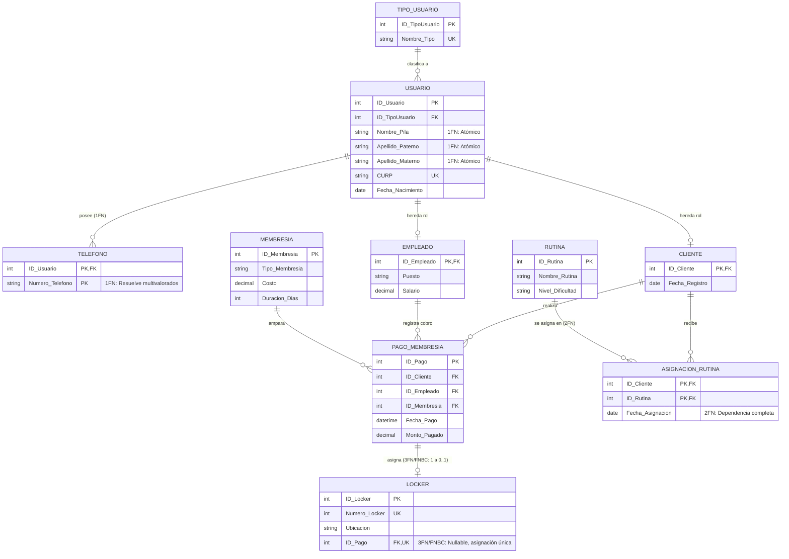

[Actividad 4.2 U_4 Fundamentos Base de datos.md]

Materia: Fundamentos Bases de Datos Actividad U.4 – Tarea 4.2 Maestro: Rubén Miguel Riojas Rodríguez Semestre: 5to Semestre Alumno: José Luis Luna García Matricula: I24050385 

### Contenido 

| Contenido  |  |
| --- | ---: |
| [**Unidad 4 – Tarea 4.2**](#unidad-4--tarea-42) | [3](#unidad-4--tarea-42) |
| [Proceso paso a paso de normalización del proyecto aplicado](#proceso-paso-a-paso-de-normalización-del-proyecto-aplicado) | [3](#proceso-paso-a-paso-de-normalización-del-proyecto-aplicado) |
| [Introducción y Planteamiento del Problema en el Proyecto](#introducción-y-planteamiento-del-problema-en-el-proyecto) | [3](#introducción-y-planteamiento-del-problema-en-el-proyecto) |
| [Estado Desnormalizado: Estructura Monolítica Inicial (0FN)](#estado-desnormalizado-estructura-monolítica-inicial-0fn) | [4](#estado-desnormalizado-estructura-monolítica-inicial-0fn) |
| [Diagnóstico de Patologías y Anomalías Detectadas en 0FN](#diagnóstico-de-patologías-y-anomalías-detectadas-en-0fn) | [5](#diagnóstico-de-patologías-y-anomalías-detectadas-en-0fn) |
| [Transición a Primera Forma Normal (1FN)](#transición-a-primera-forma-normal-1fn) | [6](#transición-a-primera-forma-normal-1fn) |
| [Transición a Segunda Forma Normal (2FN)](#transición-a-segunda-forma-normal-2fn) | [7](#transición-a-segunda-forma-normal-2fn) |
| [Transición a Tercera Forma Normal (3FN) y Validación de FNBC](#transición-a-tercera-forma-normal-3fn-y-validación-de-fnbc) | [8](#transición-a-tercera-forma-normal-3fn-y-validación-de-fnbc) |
| [Diagrama del Esquema Relacional Totalmente Normalizado (3FN / FNBC)](#diagrama-del-esquema-relacional-totalmente-normalizado-3fn--fnbc) | [10](#diagrama-del-esquema-relacional-totalmente-normalizado-3fn--fnbc) |
| [Diagrama Relacional Normalizado en 3FN / FNBC del Gimnasio](#diagrama-relacional-normalizado-en-3fn--fnbc-del-gimnasio) | [11](#diagrama-relacional-normalizado-en-3fn--fnbc-del-gimnasio) |
| [Script SQL Corregido Derivado del Esquema Totalmente Normalizado](#script-sql-corregido-derivado-del-esquema-totalmente-normalizado) | [12](#script-sql-corregido-derivado-del-esquema-totalmente-normalizado) |
| [Conclusiones y Beneficios de Integridad Obtenidos](#conclusiones-y-beneficios-de-integridad-obtenidos) | [15](#conclusiones-y-beneficios-de-integridad-obtenidos) |

# Unidad 4 – Tarea 4.2 

### Proceso paso a paso de normalización del proyecto aplicado 

## Introducción y Planteamiento del Problema en el Proyecto 

En el desarrollo de sistemas de bases de datos relacionales dedicados al procesamiento de transacciones en línea (OLTP), el diseño estructural del esquema es el factor determinante para asegurar la confiabilidad, consistencia y eficiencia del software. Cuando un sistema se concibe de manera intuitiva sin aplicar principios formales de diseño relacional, suele generarse una estructura desnormalizada en la que múltiples entidades independientes terminan concentradas en una única tabla monolítica. Esta deficiencia estructural provoca una severa redundancia de datos y desata las tres anomalías operativas clásicas: imposibilidad de registrar hechos válidos independientes (anomalía de inserción), discrepancias de información al modificar filas repetidas (anomalía de modificación) y pérdida accidental de información crítica al eliminar una tupla vinculada (anomalía de borrado). 

El presente informe técnico documenta de manera analítica y exhaustiva la transición formal paso a paso del proceso central del sistema de gestión de gimnasios: desde su estado desnormalizado inicial (0FN) hasta alcanzar un esquema relacional estricto en Tercera Forma Normal (3FN) y Forma Normal de Boyce-Codd (FNBC). Asimismo, se incorporan los diagramas visuales comparativos del esquema (el 'Antes' y el 'Después') y se concluye con el script DDL definitivo y corregido implementado en Microsoft SQL Server. 

## Estado Desnormalizado: Estructura Monolítica Inicial (0FN) 

Para evidenciar de forma directa la problemática del diseño empírico, se tomó como caso de estudio la gestión integral de suscripciones y cobros del gimnasio. En un escenario previo a la normalización (Estado 0FN), todos los atributos correspondientes a la afiliación del cliente, los números telefónicos de contacto, los datos personales y de nómina del empleado cobrador, la descripción del plan de membresía, el pago, la vigencia y el casillero asignado se almacenaban en una única entidad consolidada denominada **REGISTRO\_CONTRATO\_GIMNASIO\_0FN**: 

## Diagnóstico de Patologías y Anomalías Detectadas en 0FN 

Tal como se muestra en la tabla universal almacena 16 columnas que mezclan hechos transaccionales con catálogos y personas. El análisis formal revela cinco graves vicios de diseño: 

- **Violación de Atomicidad (1FN):** El campo 'Nombre\_Completo\_Cliente' almacena simultáneamente el nombre de pila y ambos apellidos en una misma cadena de texto, impidiendo ordenar, filtrar o indexar eficientemente por apellido paterno. 
- **Atributo Multivalorado / Grupos Repetitivos (1FN):** La columna 'Telefonos\_Cliente' almacena múltiples números en una misma celda separados por comas ('664-111, 664-222'). Esto vulnera la primera forma normal al no constituir un dominio escalar. 
- **Anomalía de Inserción:** Resulta imposible registrar un nuevo plan en el catálogo de membresías o un casillero nuevo si no se asocian obligatoriamente a la contratación de un cliente real. No pueden existir casilleros vacíos sin violar la integridad referencial o forzar valores nulos espurios. 
- **Anomalía de Modificación (Actualización):** El costo oficial de la membresía ('Costo\_Membresia'), la duración en días ('Duracion\_Dias') y el salario del empleado ('Salario\_Empleado') se repiten en cada fila de pago. Si la tarifa de una membresía se actualiza, deben modificarse potencialmente miles de registros históricos; si una fila se omite, la base de datos entra en contradicción inmediata. 
- **Anomalía de Borrado (Eliminación):** Si un cliente cancela su suscripción y se elimina su registro de contrato para dar de baja la transacción, se destruyen inadvertidamente la información física del casillero, el catálogo de la membresía y los datos del empleado cobrador. 

La siguiente tabla ilustra cómo se visualizaban los datos desordenados y redundantes en el almacenamiento físico en 0FN: 

| ID\_Contrato  | Nombre\_Completo  | Telefonos  | Tipo\_Membresia  | Costo  | Vigencia\_Fin  |
| ---: | --- | --- | --- | ---: | --- |
| 101  | Garcia Mendoza Jesus  | 664-111, 664-222  | Mensual Premium  | $650.00  | 2026-11-30  |
| 102  | Garcia Mendoza Jesus  | 664-111, 664-222  | Mensual Premium  | $650.00  | 2026-12-30  |

## Transición a Primera Forma Normal (1FN) 

Regla Fundamental de 1FN: Una relación se encuentra en Primera Forma Normal si y solo si todos los atributos contienen exclusivamente valores atómicos e indivisibles respecto a su dominio, y no existen grupos repetitivos ni atributos multivalorados dentro de una misma columna. 

Para subsanar las violaciones observadas en 0FN, se ejecutaron dos transformaciones obligatorias en el esquema: 

1. Atomización de Atributos Compuestos: La columna 'Nombre\_Completo\_Cliente' se descompuso formalmente en tres campos atómicos ('Nombre\_Pila', 'Apellido\_Paterno' y 'Apellido\_Materno'), garantizando ordenamientos y búsquedas directas sin requerir expresiones regulares. 
2. Erradicación del Atributo Multivalorado: Se eliminó la columna 'Telefonos\_Cliente' de la tabla de contratos y se creó una relación independiente subordinada denominada TELEFONO, vinculada mediante clave foránea hacia el usuario y definiendo una clave primaria compuesta por el identificador de la persona y el número telefónico: TELEFONO (ID\_Usuario \[PK, FK\], Numero\_Telefono \[PK\]). 

## Transición a Segunda Forma Normal (2FN) 

Regla Fundamental de 2FN: Una relación se encuentra en Segunda Forma Normal si satisface la 1FN y ningún atributo no clave depende funcionalmente de un subconjunto propio de una clave primaria compuesta (erradicación total de dependencias funcionales parciales). Todos los atributos descriptivos deben poseer dependencia funcional completa sobre la clave. 

En nuestro sistema, la aplicación de la 2FN se evidencia críticamente en dos aspectos fundamentales del diseño: 

1. Descomposición de la Tabla Monolítica en Tablas Maestras: Los datos descriptivos de clientes, empleados, membresías y casilleros no dependían de la transacción de pago en sí, sino de sus propios conceptos de negocio. Se crearon tablas maestras dedicadas con claves simples: MEMBRESIA (ID\_Membresia \[PK\]), EMPLEADO (ID\_Empleado \[PK\]) y LOCKER (ID\_Locker \[PK\]). 
2. Resolución de Relaciones N:M y Dependencia Completa en ASIGNACION\_RUTINA: En la relación muchos a muchos entre clientes y rutinas se generó la tabla asociativa con clave primaria compuesta: (ID\_Cliente, ID\_Rutina). Si en dicha tabla se hubiesen mantenido datos como 'Nombre\_Cliente' o 'Nivel\_Dificultad\_Rutina', existirían dependencias parciales gravísimas ({ID\_Cliente} -\> Nombre\_Cliente y {ID\_Rutina} -\> Nivel\_Dificultad). En estricto apego a 2FN, esos atributos se mantuvieron en CLIENTE y RUTINA, conservando en ASIGNACION\_RUTINA únicamente el atributo con dependencia funcional completa: {ID\_Cliente, ID\_Rutina} -\> Fecha\_Asignacion. 

## Transición a Tercera Forma Normal (3FN) y Validación de FNBC 

Regla Fundamental de 3FN y FNBC: Una relación está en 3FN si cumple 2FN y ningún atributo no clave depende transitivamente de la clave primaria (es decir, ningún atributo no clave determina a otro atributo no clave: X -\> Y y Y -\> Z donde Y no es clave). La Forma Normal de Boyce-Codd (FNBC) añade la restricción estricta de que todo determinante funcional debe ser forzosamente una clave candidata o superclave. 

Durante esta fase se implementaron tres correcciones determinantes en el proyecto del gimnasio: 

1. Supresión del Atributo Derivado 'Vigencia\_Fin' en PAGO\_MEMBRESIA: En 2FN se contemplaba almacenar físicamente la fecha de vencimiento. Sin embargo, dicho valor está determinado funcionalmente por {Fecha\_Pago + MEMBRESIA.Duracion\_Dias}. Mantenerlo como columna física generaba una dependencia funcional transitiva y anomalías de actualización si se recalcula la duración del plan. En 3FN, la columna física se eliminó por completo, obteniéndose dinámicamente mediante funciones de fecha en SQL (DATEADD). 
2. Desacoplamiento de Asignación y Cumplimiento de FNBC en LOCKER: Inicialmente, la tabla PAGO\_MEMBRESIA contenía una clave foránea ID\_Locker. Esto obligaba a que los clientes sin casillero tuvieran valores NULL en la transacción o que no pudieran existir casilleros libres sin contratos. La relación se corrigió ubicando ID\_Pago en la tabla LOCKER con restricción UNIQUE y permitiendo valores NULL. Esto garantiza que: (a) un casillero solo se asocie a un pago a la vez, (b) existan casilleros libres sin violar integridad y (c) todo determinante sea clave candidata única (FNBC). 
3. Especialización Limpia (Superclase USUARIO -\> Subclases CLIENTE / EMPLEADO): Para erradicar la duplicidad de atributos de personas (nombres, CURP, fechas de nacimiento) en dos tablas distintas, se centralizaron en la superclase USUARIO. CLIENTE y EMPLEADO heredan ID\_Usuario como clave primaria y clave foránea simultánea. 

La siguiente matriz comparativa resume la evolución metodológica del esquema en sus cuatro etapas: 

| **Fase / Nivel**  | **Estructuras Afectadas**  | **Patología o Deficiencia Erradicada**  | **Condición Resultante**  |
| --- | --- | --- | --- |
| **Estado 0FN**  | REGISTRO\_CONTRATO\_GIMNASIO  | Valores no atómicos, listas de teléfonos, anomalías de inserción, actualización y borrado.  | Tabla plana universal altamente redundante.  |
| **1FN**  | USUARIO, TELEFONO  | Violación de atomicidad en nombres y atributos multivalorados en teléfonos.  | Celdas estrictamente atómicas y tabla subordinada de teléfonos con PK compuesta.  |
| **2FN**  | ASIGNACION\_RUTINA, RUTINA, MEMBRESIA  | Dependencias funcionales parciales en claves compuestas de tablas intermedias.  | Todos los atributos no clave dependen de la totalidad de la clave primaria compuesta.  |
| **3FN / FNBC**  | PAGO\_MEMBRESIA, LOCKER, USUARIO  | Dependencias transitivas (vigencia derivada) y acoplamiento indebido de casilleros.  | Eliminación de campos calculados, casillero con FK UNIQUE nullable y herencia limpia.  |

## Diagrama del Esquema Relacional Totalmente Normalizado (3FN / FNBC) 

Como resultado de la aplicación rigurosa de las reglas de 1FN, 2FN, 3FN y validación de FNBC, el sistema monolítico original se descompone armónicamente en 10 entidades fuertemente tipadas y vinculadas por integridad referencial estricta. La Figura 2 presenta el esquema relacional normalizado y definitivo: 

## Diagrama Relacional Normalizado en 3FN / FNBC del Gimnasio 

- TIPO\_USUARIO clasifica el rol del usuario (Socio o Personal). 
- USUARIO garantiza la atomicidad de nombres y almacena CURP único y fecha de nacimiento. 
- TELEFONO resuelve la multivaluación con clave primaria compuesta (ID\_Usuario, Numero\_Telefono). 
- CLIENTE y EMPLEADO heredan directamente la clave primaria de USUARIO como clave foránea. 
- PAGO\_MEMBRESIA concentra los hechos transaccionales puros vinculando al cliente, empleado y membresía sin duplicar tarifas ni vigencias calculadas. 
- LOCKER posee una clave foránea ID\_Pago con restricción de unicidad (UNIQUE) y soporte de nulos, permitiendo casilleros libres y garantizando que un pago solo posea un casillero (FNBC). 
- ASIGNACION\_RUTINA enlaza clientes y rutinas con clave compuesta y dependencia funcional completa sobre Fecha\_Asignacion. 

## Script SQL Corregido Derivado del Esquema Totalmente Normalizado 

El siguiente script DDL para Microsoft SQL Server representa la implementación física exacta del esquema relacional en 3FN/FNBC. Incluye la creación estructurada de la base de datos, tipos de datos atómicos, claves primarias, claves foráneas, restricciones de regla de negocio (CHECK), restricciones de unicidad (UNIQUE) y reglas de acción referencial (ON DELETE CASCADE y SET NULL): 

CREATE DATABASE gimnasio\_normalizado; GO 

 USE gimnasio\_normalizado; 

GO 

-- 1. TABLA CATÁLOGO: TIPO\_USUARIO CREATE TABLE TIPO\_USUARIO ( 

 ID\_TipoUsuario INT IDENTITY(1,1), Nombre\_Tipo VARCHAR(50) NOT NULL, 

 CONSTRAINT PK\_TipoUsuario PRIMARY KEY (ID\_TipoUsuario), CONSTRAINT UQ\_TipoUsuario\_Nombre UNIQUE (Nombre\_Tipo) ); 

GO 

-- 2. TABLA SUPERCLASE: USUARIO (1FN: Atributos estrictamente atómicos) CREATE TABLE USUARIO ( 

 ID\_Usuario INT IDENTITY(1,1), ID\_TipoUsuario INT NOT NULL, 

 Nombre\_Pila VARCHAR(50) NOT NULL, Apellido\_Paterno VARCHAR(50) NOT NULL, 

 Apellido\_Materno VARCHAR(50) NULL, CURP CHAR(18) NOT NULL, 

 Fecha\_Nacimiento DATE NOT NULL, CONSTRAINT PK\_Usuario PRIMARY KEY (ID\_Usuario), 

 CONSTRAINT UQ\_Usuario\_CURP UNIQUE (CURP), CONSTRAINT FK\_Usuario\_TipoUsuario FOREIGN KEY (ID\_TipoUsuario) REFERENCES TIPO\_USUARIO(ID\_TipoUsuario) 

); GO 

 -- 3. TABLA SUBORDINADA: TELEFONO (1FN: Aislamiento de atributos multivalorados) CREATE TABLE TELEFONO ( 

 ID\_Usuario INT NOT NULL, Numero\_Telefono VARCHAR(15) NOT NULL, 

 CONSTRAINT PK\_Telefono PRIMARY KEY (ID\_Usuario, Numero\_Telefono), CONSTRAINT FK\_Telefono\_Usuario FOREIGN KEY (ID\_Usuario) REFERENCES USUARIO(ID\_Usuario) ON DELETE CASCADE ); 

GO 

-- 4. TABLA SUBCLASE: CLIENTE (Herencia de clave primaria/foránea) CREATE TABLE CLIENTE ( 

 ID\_Cliente INT NOT NULL, Fecha\_Registro DATE NOT NULL DEFAULT GETDATE(), CONSTRAINT PK\_Cliente PRIMARY KEY (ID\_Cliente), CONSTRAINT FK\_Cliente\_Usuario FOREIGN KEY (ID\_Cliente) REFERENCES USUARIO(ID\_Usuario) ON DELETE CASCADE ); 

GO 

-- 5. TABLA SUBCLASE: EMPLEADO (Herencia y restricción CHECK de dominio) CREATE TABLE EMPLEADO ( 

 ID\_Empleado INT NOT NULL, Puesto VARCHAR(50) NOT NULL, 

 Salario DECIMAL(10,2) NOT NULL, CONSTRAINT PK\_Empleado PRIMARY KEY (ID\_Empleado), CONSTRAINT CK\_Empleado\_Salario CHECK (Salario \> 0), CONSTRAINT FK\_Empleado\_Usuario FOREIGN KEY (ID\_Empleado) REFERENCES USUARIO(ID\_Usuario) ON DELETE CASCADE ); 

GO 

-- 6. TABLA MAESTRA: MEMBRESIA (Catálogo de planes independientes) CREATE TABLE MEMBRESIA ( 

 ID\_Membresia INT IDENTITY(1,1), Tipo\_Membresia VARCHAR(50) NOT NULL, 

 Costo DECIMAL(10,2) NOT NULL, Duracion\_Dias INT NOT NULL, 

 CONSTRAINT PK\_Membresia PRIMARY KEY (ID\_Membresia), CONSTRAINT CK\_Membresia\_Costo CHECK (Costo \>= 0), CONSTRAINT CK\_Membresia\_Dias CHECK (Duracion\_Dias \> 0) ); 

GO 

-- 7. TABLA TRANSACCIONAL: PAGO\_MEMBRESIA (3FN: Sin vigencia física calculada) CREATE TABLE PAGO\_MEMBRESIA ( 

 ID\_Pago INT IDENTITY(1,1), 

 ID\_Cliente INT NOT NULL, ID\_Empleado INT NOT NULL, 

 ID\_Membresia INT NOT NULL, Fecha\_Pago DATETIME NOT NULL DEFAULT GETDATE(), Monto\_Pagado DECIMAL(10,2) NOT NULL, 

 CONSTRAINT PK\_PagoMembresia PRIMARY KEY (ID\_Pago), CONSTRAINT CK\_Pago\_Monto CHECK (Monto\_Pagado \>= 0), CONSTRAINT FK\_Pago\_Cliente FOREIGN KEY (ID\_Cliente) REFERENCES CLIENTE(ID\_Cliente), 

 CONSTRAINT FK\_Pago\_Empleado FOREIGN KEY (ID\_Empleado) REFERENCES EMPLEADO(ID\_Empleado), CONSTRAINT FK\_Pago\_Membresia FOREIGN KEY (ID\_Membresia) REFERENCES MEMBRESIA(ID\_Membresia) ); 

GO 

-- 8. TABLA MAESTRA: LOCKER (3FN/FNBC: Asignación 1 a 0..1 con FK UNIQUE) CREATE TABLE LOCKER ( 

 ID\_Locker INT IDENTITY(1,1), Numero\_Locker INT NOT NULL, 

 Ubicacion VARCHAR(50) NOT NULL, ID\_Pago INT NULL, -- NULL representa casillero desocupado CONSTRAINT PK\_Locker PRIMARY KEY (ID\_Locker), CONSTRAINT UQ\_Locker\_Numero UNIQUE (Numero\_Locker), CONSTRAINT UQ\_Locker\_Pago UNIQUE (ID\_Pago), -- Garantiza FNBC (un casillero por pago) CONSTRAINT FK\_Locker\_Pago FOREIGN KEY (ID\_Pago) REFERENCES PAGO\_MEMBRESIA(ID\_Pago) ON DELETE SET NULL ); 

GO 

-- 9. TABLA MAESTRA: RUTINA (Catálogo independiente) CREATE TABLE RUTINA ( 

 ID\_Rutina INT IDENTITY(1,1), Nombre\_Rutina VARCHAR(100) NOT NULL, Nivel\_Dificultad VARCHAR(20) NOT NULL, 

 CONSTRAINT PK\_Rutina PRIMARY KEY (ID\_Rutina) ); 

GO 

-- 10. TABLA ASOCIATIVA: ASIGNACION\_RUTINA (2FN: Dependencia completa) CREATE TABLE ASIGNACION\_RUTINA ( 

 ID\_Cliente INT NOT NULL, ID\_Rutina INT NOT NULL, 

 Fecha\_Asignacion DATE NOT NULL DEFAULT GETDATE(), CONSTRAINT PK\_AsignacionRutina PRIMARY KEY (ID\_Cliente, ID\_Rutina), CONSTRAINT FK\_Asignacion\_Cliente FOREIGN KEY (ID\_Cliente) 

 REFERENCES CLIENTE(ID\_Cliente) ON DELETE CASCADE, CONSTRAINT FK\_Asignacion\_Rutina FOREIGN KEY (ID\_Rutina) 

 REFERENCES RUTINA(ID\_Rutina) ON DELETE CASCADE ); 

GO 

## Conclusiones y Beneficios de Integridad Obtenidos 

- **Erradicación Absoluta de Redundancias:** Al descomponer la entidad desnormalizada en 10 tablas especializadas, los datos de catálogos y personas se almacenan una sola vez, optimizando el consumo de disco y acelerando las operaciones de escritura. 
- **Blindaje contra Anomalías Transaccionales:** El esquema normalizado permite dar de alta miembros, crear membresías y registrar casilleros sin forzar asociaciones artificiales; la actualización de precios impacta únicamente a filas maestras y el borrado de pagos no destruye la infraestructura física del gimnasio. 
- **Garantía Declarativa a Nivel de Motor:** Mediante el uso estratégico de claves primarias, foráneas con ON DELETE CASCADE/SET NULL, restricciones CHECK y restricciones UNIQUE, la integridad de los datos queda protegida directamente por SQL Server, sin depender de validaciones en la capa de interfaz de usuario. 
