[Actividad 5.1 U_5 Fundamentos Base de datos.md]

Materia: Fundamentos Bases de Datos Actividad U.5 – Tarea 5.1 Maestro: Rubén Miguel Riojas Rodríguez Semestre: 5to Semestre Alumno: José Luis Luna García Matricula: I24050385 

### Contenido 

| Contenido  |  |
| --- | ---: |
| [**Unidad 5 – Tarea 5.1**](#unidad-5--tarea-51) | [3](#unidad-5--tarea-51) |
| [Mapa conceptual con las operadores fundamentales y extendidos del álgebra relacional](#mapa-conceptual-con-las-operadores-fundamentales-y-extendidos-del-álgebra-relacional) | [3](#mapa-conceptual-con-las-operadores-fundamentales-y-extendidos-del-álgebra-relacional) |
| [Referencias](#referencias) | [4](#referencias) |

# Unidad 5 – Tarea 5.1 

## Mapa conceptual con las operadores fundamentales y extendidos del álgebra relacional 

```mermaid
flowchart TD
    %% ==========================================
    %% NODO PRINCIPAL Y DEFINICIÓN SUPERIOR
    %% ==========================================
    TITULO["<b>ÁLGEBRA RELACIONAL</b>"]
    DEF["<b>¿Qué es?</b><br />Lenguaje formal procedimental de consulta basado en la teoría de conjuntos y lógica de predicados.<br /><i>Propiedad de clausura:</i> Toma relaciones como entrada y produce siempre una nueva relación como resultado."]
    
    TITULO --- DEF

    %% ==========================================
    %% TRES COLUMNAS PRINCIPALES
    %% ==========================================
    DEF --> COL1["<b>OPERADORES UNARIOS</b><br /><i>(Una sola relación R)</i>"]
    DEF --> COL2["<b>OPERADORES BINARIOS BÁSICOS</b><br /><i>(Pares de relaciones R y S)</i>"]
    DEF --> COL3["<b>ÁLGEBRA RELACIONAL EXTENDIDA</b><br /><i>(Operaciones analíticas avanzadas)</i>"]

    %% ==========================================
    %% COLUMNA 1: OPERADORES UNARIOS
    %% ==========================================
    COL1 --> U1["<b>Selección: σ (Sigma)</b><br />• <b>Notación:</b> σ_condición (R)<br />• <b>Función:</b> Filtra filas que cumplen una condición lógica.<br />• <b>Ejemplo:</b> Clientes que viven en Tijuana.<br />• <b>Equivalencia SQL:</b> WHERE"]
    COL1 --> U2["<b>Proyección: π (Pi)</b><br />• <b>Notación:</b> π_atributos (R)<br />• <b>Función:</b> Selecciona columnas específicas y elimina duplicados.<br />• <b>Ejemplo:</b> Ver solo Nombre y Teléfono.<br />• <b>Equivalencia SQL:</b> SELECT DISTINCT"]
    COL1 --> U3["<b>Renombramiento: ρ (Rho)</b><br />• <b>Notación:</b> ρ_nuevo_nombre (R)<br />• <b>Función:</b> Asigna un alias temporal a tablas o atributos.<br />• <b>Equivalencia SQL:</b> AS"]

    %% ==========================================
    %% COLUMNA 2: OPERADORES BINARIOS BÁSICOS
    %% ==========================================
    COL2 --> B_CONJ["<b>A. Operaciones de Conjuntos</b><br /><i>(Exigen compatibilidad de unión: mismo grado y dominios afines)</i>"]
    
    B_CONJ --> B1["<b>Unión: ∪</b><br />• <b>Notación:</b> R ∪ S<br />• Combina registros descartando duplicados.<br />• <b>Ejemplo:</b> Clientes del turno matutino con los del vespertino."]
    B_CONJ --> B2["<b>Intersección: ∩</b><br />• <b>Notación:</b> R ∩ S<br />• Registros que aparecen al mismo tiempo en ambas tablas.<br />• <b>Ejemplo:</b> Personas inscritas en pesas y natación."]
    B_CONJ --> B3["<b>Diferencia: −</b><br />• <b>Notación:</b> R − S<br />• Registros en la primera tabla que no existen en la segunda.<br />• <b>Ejemplo:</b> Clientes registrados sin ningún pago."]

    COL2 --> B_CRUCE["<b>B. Operaciones de Cruce y Combinación</b>"]
    
    B_CRUCE --> B4["<b>Producto Cartesiano: ×</b><br />• <b>Notación:</b> R × S<br />• Cruza cada fila de R con todas las filas de S.<br />• Multiplica la cantidad total de registros."]
    B_CRUCE --> B5["<b>Reunión o Join: ⋈ (Corbatín)</b><br />• <b>Notación:</b> R ⋈_condición S<br />• <b>Reunión Natural (⋈):</b> Iguala columnas homónimas y elimina repetidas."]
    B_CRUCE --> B6["<b>División: ÷</b><br />• <b>Notación:</b> R ÷ S<br />• Busca registros asociados con TODOS los elementos de otra tabla.<br />• <b>Ejemplo:</b> Socios que cursaron todos los talleres disponibles."]

    %% ==========================================
    %% COLUMNA 3: ÁLGEBRA RELACIONAL EXTENDIDA
    %% ==========================================
    COL3 --> E1["<b>Proyección Generalizada: π*</b><br />• <b>Notación:</b> π_F1, F2, ..., Fn (R)<br />• Permite cálculos aritméticos, fórmulas y constantes.<br />• <b>Ejemplo:</b> Sueldo * 1.10"]
    COL3 --> E2["<b>Agregación y Agrupamiento: 𝒢 / G</b><br />• <b>Notación:</b> _agrupamiento 𝒢 _funciones (R)<br />• Aplica métricas estadísticas: SUM, AVG, COUNT, MIN, MAX.<br />• <b>Equivalencia SQL:</b> GROUP BY"]
    COL3 --> E3["<b>Reuniones Externas (Outer Joins)</b><br />• Evitan la pérdida de datos rellenando con valores NULL:<br />  • <b>Left Outer Join (⟕):</b> Conserva todas las filas de la izquierda.<br />  • <b>Right Outer Join (⟖):</b> Conserva todas las filas de la derecha.<br />  • <b>Full Outer Join (⟗):</b> Conserva todas las filas de ambas tablas."]

    %% ==========================================
    %% ESTILOS VISUALES
    %% ==========================================
    classDef headerStyle fill:#1A365D,stroke:#0F172A,stroke-width:2px,color:#FFFFFF,font-size:16px;
    classDef defStyle fill:#2B6CB0,stroke:#1A365D,stroke-width:1.5px,color:#FFFFFF,font-size:13px;
    classDef colStyle fill:#CBD5E1,stroke:#475569,stroke-width:2px,color:#0F172A,font-size:14px,font-weight:bold;
    classDef subCatStyle fill:#E2E8F0,stroke:#64748B,stroke-width:1.5px,color:#1E293B,font-weight:bold;
    classDef itemStyle fill:#F8FAFC,stroke:#94A3B8,stroke-width:1px,color:#334155,font-size:12px,text-align:left;

    class TITULO headerStyle;
    class DEF defStyle;
    class COL1,COL2,COL3 colStyle;
    class B_CONJ,B_CRUCE subCatStyle;
    class U1,U2,U3,B1,B2,B3,B4,B5,B6,E1,E2,E3 itemStyle;
```

 (catedras, s.f.) (geeksforgeeks, s.f.) (uv, s.f.) (scribd, s.f.) 

# Referencias 

_catedras_. (s.f.). Obtenido de https://catedras.facet.unt.edu.ar/bd/wp-content/uploads/sites/30/2018/10/Bases-de-Datos-Unidad-IV-2018-Parte-I.pdf 

_geeksforgeeks_. (s.f.). Obtenido de https://www-geeksforgeeks-org.translate.goog/dbms/what-are-the-unary-operations-in-relational-algebra/?\_x\_tr\_sl=en&\_x\_tr\_tl=es&\_x\_tr\_hl=es&\_x\_tr\_pto=tc&\_x\_tr\_hist=true 

_scribd_. (s.f.). Obtenido de https://es.scribd.com/document/407428064/Algebra-Relacional 

_uv_. (s.f.). Obtenido de https://www.uv.mx/personal/ermeneses/files/2020/09/Clase9-OperacionesBDRelacionales-I.pdf 
