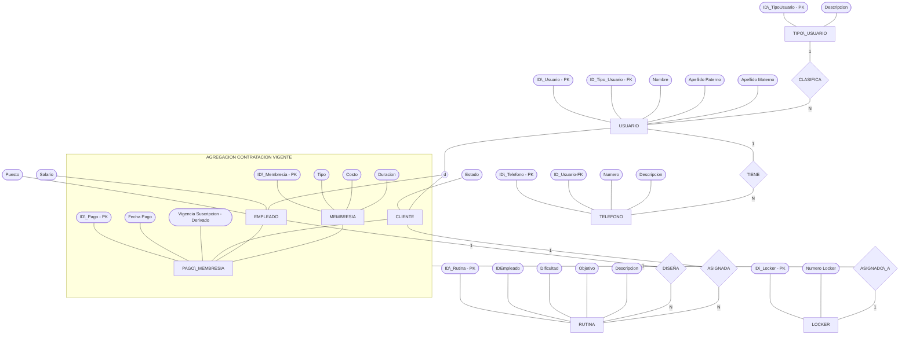

[Actividad 2.1 U_2 Fundamentos Base de datos.md](https://github.com/user-attachments/files/34228345/Actividad.2.1.U_2.Fundamentos.Base.de.datos.md)

Materia: Fundamentos Bases de Datos Actividad U.2 – Tarea 2.1 Maestro: Rubén Miguel Riojas Rodríguez Semestre: 5to Semestre Alumno: José Luis Luna García Matricula: I24050385 

### Contenido 

| Contenido  |  |
| --- | ---: |
| [Unidad 2 - Tarea 2.1](#unidad-2---tarea-21) | [3](#unidad-2---tarea-21) |
| [Selecciona un caso de estudio o problemática real del entorno](#selecciona-un-caso-de-estudio-o-problemática-real-del-entorno) | [3](#selecciona-un-caso-de-estudio-o-problemática-real-del-entorno) |
| [Descripción Contextual y Problemática del Entorno](#descripción-contextual-y-problemática-del-entorno) | [3](#descripción-contextual-y-problemática-del-entorno) |
| [Reglas de Negocio del Sistema](#reglas-de-negocio-del-sistema) | [3](#reglas-de-negocio-del-sistema) |
| [Identificación y Clasificación de Entidades y Atributos](#identificación-y-clasificación-de-entidades-y-atributos) | [4](#identificación-y-clasificación-de-entidades-y-atributos) |
| [Matriz de Relaciones y Restricciones de Participación](#matriz-de-relaciones-y-restricciones-de-participación) | [5](#matriz-de-relaciones-y-restricciones-de-participación) |
| [Aplicación de Conceptos del Modelo E-R Extendido](#aplicación-de-conceptos-del-modelo-e-r-extendido) | [6](#aplicación-de-conceptos-del-modelo-e-r-extendido) |
| [Diseño del Diagrama Entidad-Relación (Herramienta CASE)](#diseño-del-diagrama-entidad-relación-herramienta-case) | [7](#diseño-del-diagrama-entidad-relación-herramienta-case) |
| [Conclusión y Recomendaciones Técnicas](#conclusión-y-recomendaciones-técnicas) | [8](#conclusión-y-recomendaciones-técnicas) |

# Unidad 2 - Tarea 2.1 

## Selecciona un caso de estudio o problemática real del entorno 

### Descripción Contextual y Problemática del Entorno 

El presente caso de estudio aborda la problemática operativa y administrativa de un centro deportivo (gimnasio) que experimenta severas deficiencias operativas debido a la falta de un sistema de información centralizado. Actualmente, el control de acceso de los socios, la cobranza de las cuotas de membresía, la asignación de casilleros (lockers) y el seguimiento de las rutinas de entrenamiento personalizadas se llevan a cabo de manera manual o aislada. Esto genera duplicidad de datos personales, incertidumbre respecto a la vigencia de las suscripciones y pérdidas de tiempo operativo tanto para los entrenadores como para el personal administrativo. 

Con el propósito de resolver estas deficiencias, se diseñó una arquitectura de base de datos relacional basada en el Modelo Entidad-Relación Extendido (EER). Esta solución unifica el registro de usuarios, automatiza el control de pagos, formaliza la asignación de infraestructura física mediante el concepto de agregación y vincula las rutinas creadas por el personal técnico con los objetivos individuales de cada socio. 

### Reglas de Negocio del Sistema 

Las siguientes reglas de negocio normativas rigen la lógica de operación del centro deportivo y fundamentan la integridad del modelo conceptual de datos: 

**RN1 - Identificación Única de Usuarios:** Todo usuario registrado en el sistema debe poseer un identificador único (ID) y asociarse obligatoriamente a una clasificación o tipo de usuario (TIPO\_USUARIO). 

**RN2 - Especialización de Roles:** Un usuario registrado se categoriza formalmente en la base de datos como socio (CLIENTE) o como personal de trabajo (EMPLEADO), heredando la información personal general almacenada en la entidad padre USUARIO. 

**RN3 - Contactos Telefónicos Múltiples:** Un usuario puede registrar cero, uno o múltiples números telefónicos de contacto (TELEFONO) para su localización, sin incurrir en duplicidad de sus datos personales. 

**RN4 - Asignación de Lockers mediante Contratación Vigente:** La asignación de un casillero (LOCKER) no se realiza directamente sobre el cliente de forma aislada, sino sobre su contratación pagada activa (CONTRATACIÓN\_VIGENTE). Un socio con cuota vigente puede tener asignado como máximo un casillero activo a la vez. 

**RN5 - Transacción de Pagos y Atributo Derivado:** Todo pago de membresía (PAGO\_MEMBRESIA) exige vincular obligatoriamente al cliente que realiza la transacción, la membresía adquirida y el empleado que atiende el cobro. La vigencia de la suscripción se calcula como un atributo derivado a partir de la fecha de pago y la duración de la membresía. 

**RN6 - Diseño y Asignación de Rutinas:** Toda rutina de entrenamiento (RUTINA) debe ser diseñada por un entrenador (EMPLEADO) indicando su nivel de dificultad y objetivo, para posteriormente asignarse a uno o más socios (CLIENTE). 

### Identificación y Clasificación de Entidades y Atributos 

El modelo se compone de entidades principales y una tipificación rigurosa de sus atributos: 

- **Atributos Clave (Primary Keys):** Identificadores primarios únicos (PK) definidos en cada una de las entidades del sistema (USUARIO, TIPO\_USUARIO, 

| TELEFONO, CLIENTE,  | EMPLEADO,  | LOCKER, MEMBRESIA,  |
| --- | --- | --- |
| PAGO\_MEMBRESIA y RUTINA). |  |  |
| desglosa formalmente en  | NOMBRE,  | APELLIDO\_PATERNO y  |

APELLIDO\_MATERNO para facilitar la búsqueda, ordenamiento y consistencia de registros. 

- **Atributo Multivalorado:** Los contactos telefónicos se modelan mediante la entidad independiente TELEFONO con relación 1:N respecto a USUARIO, permitiendo registrar múltiples números sin redundancia. 
- **Atributo Derivado:** El atributo VIGENCIA DE SUSCRIPCIÓN en la transacción de pago se calcula dinámicamente sumando la DURACIÓN de la MEMBRESIA a la FECHA\_DE\_PAGO. 

### Matriz de Relaciones y Restricciones de Participación 

### A continuación, se detalla la estructura formal de las relaciones entre entidades, especificando las cardinalidades, los grados de participación y los conceptos avanzados del Modelo EER aplicados en el nuevo diagrama: 

| **Relación**  | **Entidades Participantes**  | **Cardinalidad**  | **Restricción de Participación / Descripción**  |
| --- | --- | --- | --- |
| **CLASIFICA**  | **TIPO\_USUARIO – USUARIO**  | **1:N**  | Parcial (0,N) : Total (1,1) Todo usuario debe pertenecer obligatoriamente a un tipo.  |
| **TIENE**  | **USUARIO – TELEFONO**  | **1:N**  | Parcial (0,N) : Total (1,1) Un usuario puede tener múltiples teléfonos. Todo teléfono pertenece a un usuario.  |
| **ESPECIALIZACIÓN (d)**  | **USUARIO → (CLIENTE / EMPLEADO)**  | **1:1**  | Especialización Disjunta Cliente y Empleado heredan atributos generales de Usuario de forma exclusiva.  |
| **REALIZA / ATIENDE / APLICA A**  | **CLIENTE / EMPLEADO / MEMBRESIA – PAGO\_MEMBRESIA**  | **1:N**  | Parcial (0,N) : Total (1,1) Todo pago exige vincular al cliente pagador, al empleado cobrador y el tipo de membresía.  |
| **AGREGACIÓN (CONTRATACIÓN VIGENTE)**  | **Abstrae la transacción PAGO\_MEMBRESIA entre CLIENTE y MEMBRESIA**  | **N/A**  | Abstracción de Alto Nivel Representa la suscripción pagada y activa del cliente dentro del sistema.  |
| **ASIGNADA\_A**  | **CONTRATACIÓN\_VIGENTE – LOCKER**  | **1:1**  | Parcial (0,1) : Total (1,1) Un locker se asigna a la contratación vigente (cuota activa), no al cliente aislado.  |
| **DISEÑA**  | **EMPLEADO – RUTINA**  | **1:N**  | Parcial (0,N) : Total (1,1) Un entrenador diseña múltiples rutinas. Toda rutina tiene un empleado creador.  |
| **ASIGNADA**  | **CLIENTE – RUTINA**  | **N:1 (o N:M)**  | Parcial (0,N) : Total (1,1) N:1 para rutinas personalizadas exclusivamente por socio; N:M si se usan plantillas.  |

### Aplicación de Conceptos del Modelo E-R Extendido 

1. **Especialización / Generalización y Jerarquías Disjuntas** 

Se aplicó el concepto de herencia mediante una jerarquía de especialización disjunta (representada con el símbolo 'd') entre la entidad padre USUARIO y las entidades hijas CLIENTE y EMPLEADO. Esta abstracción elimina completamente la duplicación de atributos comunes (como nombre, apellidos y teléfonos), almacenándolos una sola vez en USUARIO. Por su parte, los atributos específicos de cada rol (tales como puesto y salario en el caso de empleados, o estado en clientes) se mantienen de manera exclusiva en sus respectivas subclases. 

1. **Concepto de Agregación (CONTRATACIÓN\_VIGENTE)** 

La agregación es una abstracción avanzada del Modelo EER que permite tratar una relación entre múltiples entidades como una entidad de mayor nivel. En este caso de estudio, la transacción de cobro PAGO\_MEMBRESIA que vincula a CLIENTE, EMPLEADO y MEMBRESIA se abstrae conceptualmente dentro del marco de agregación denominado CONTRATACIÓN\_VIGENTE. Gracias a este diseño, la asignación del casillero (LOCKER) no se conecta al socio de forma aislada, sino directamente a su CONTRATACIÓN\_VIGENTE activa, garantizando el cumplimiento estricto de la regla RN4 (solo los socios con cuota al corriente pueden tener locker). 

### Diseño del Diagrama Entidad-Relación (Herramienta CASE) 

El diagrama conceptual E-R del sistema fue modelado formalmente utilizando la herramienta CASE draw.io (DIAGRAMA\_GIMNASIO\_NUEVO.drawio.png). En este nuevo modelo visual se representan las entidades, la jerarquía de herencia disjunta ('d'), la agregación de Contratación Vigente, las relaciones cardinales (1:1, 1:N, N:M) y la clasificación exacta de atributos (compuestos, multivalorados y derivados). 

### Conclusión y Recomendaciones Técnicas 

El diseño actualizado del Modelo Entidad-Relación Extendido proporciona una estructura altamente robusta, escalable y exenta de redundancias para la gestión integral del gimnasio. La aplicación rigurosa de la especialización disjunta y del concepto de agregación resuelve definitivamente los problemas de duplicación de datos y la desorganización operativa en la asignación de casilleros y control de suscripciones. 
