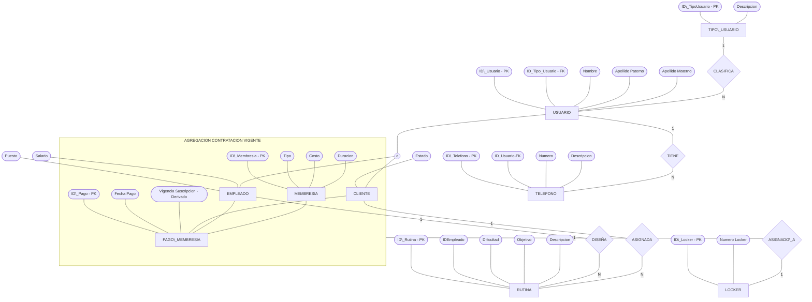
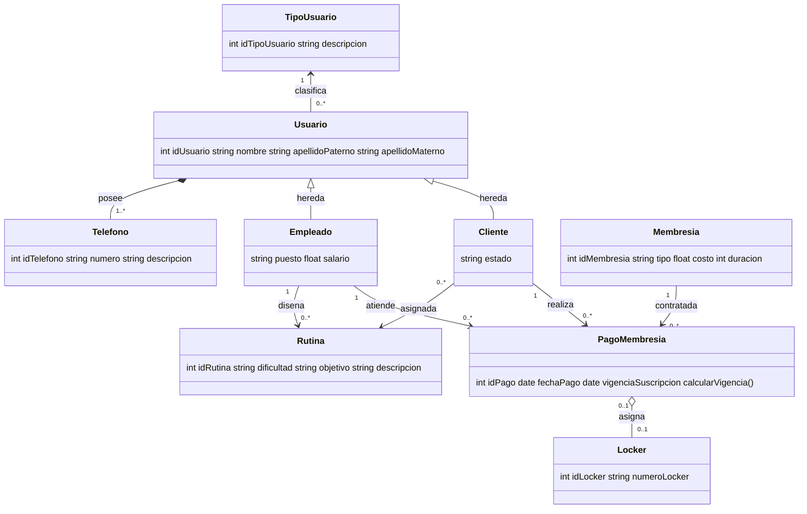

[Actividad 2.2 U_2 Fundamentos Base de datos.md](https://github.com/user-attachments/files/34228379/Actividad.2.2.U_2.Fundamentos.Base.de.datos.md)

Materia: Fundamentos Bases de Datos Actividad U.2 – Tarea 2.2 Maestro: Rubén Miguel Riojas Rodríguez Semestre: 5to Semestre Alumno: José Luis Luna García Matricula: I24050385 

### Contenido 

| Contenido  |  |
| --- | ---: |
| [Unidad 2 – Tarea 2.2](#unidad-2--tarea-22) | [3](#unidad-2--tarea-22) |
| [Transición de diagrama E-R a notación UML](#transición-de-diagrama-e-r-a-notación-uml) | [3](#transición-de-diagrama-e-r-a-notación-uml) |
| [El Modelo Entidad-Relación Extendido (EER) Conceptual](#el-modelo-entidad-relación-extendido-eer-conceptual) | [3](#el-modelo-entidad-relación-extendido-eer-conceptual) |
| [Fundamentos y Mecanismos Avanzados del Modelo EER](#fundamentos-y-mecanismos-avanzados-del-modelo-eer) | [4](#fundamentos-y-mecanismos-avanzados-del-modelo-eer) |
| [Conversión a Diagrama de Clases en Notación UML](#conversión-a-diagrama-de-clases-en-notación-uml) | [5](#conversión-a-diagrama-de-clases-en-notación-uml) |
| [Matriz de Correspondencia Directa: EER vs. UML](#matriz-de-correspondencia-directa-eer-vs-uml) | [6](#matriz-de-correspondencia-directa-eer-vs-uml) |
| [Especificación Estructural del Diagrama de Clases](#especificación-estructural-del-diagrama-de-clases) | [7](#especificación-estructural-del-diagrama-de-clases) |
| [Conclusión y Validación del Diseño](#conclusión-y-validación-del-diseño) | [7](#conclusión-y-validación-del-diseño) |

# Unidad 2 – Tarea 2.2 

## Transición de diagrama E-R a notación UML 

### El Modelo Entidad-Relación Extendido (EER) Conceptual 

El punto de partida de la arquitectura de datos es el **Modelo Entidad-Relación Extendido (EER)**, diseñado para resolver la desarticulación operativa del centro deportivo. Este modelo integra la gestión de socios, cobranzas, casilleros y planes de entrenamiento bajo un esquema riguroso que previene la duplicidad y las inconsistencias en la vigencia de los servicios. 

### Fundamentos y Mecanismos Avanzados del Modelo EER 

El diagrama EER incorpora tres abstracciones estructurales fundamentales: 

- **Jerarquía de Herencia y Especialización Disjunta (d):** La entidad superclase USUARIO centraliza los atributos personales comunes (Nombre completo con desglose compuesto). A través del círculo de disyunción (d), se especializa de forma mutuamente excluyente en las subclases CLIENTE y EMPLEADO. De este modo, un usuario no puede pertenecer a ambos roles simultáneamente en la misma instancia y se elimina toda redundancia de almacenamiento. 
- **Mecanismo de Agregación (CONTRATACIÓN VIGENTE):** La transacción PAGO\_MEMBRESIA vincula ternariamente a CLIENTE, EMPLEADO y MEMBRESIA. Para modelar conceptualmente que la asignación de un casillero físico (LOCKER) depende de una cuota activa y no del socio aislado, se aplica una agregación que encapsula dicha relación. Así, LOCKER se asocia directamente a la contratación en estado vigente (1 a 1). 
- **Clasificación Normativa de Atributos:** El modelo implementa atributos compuestos (NOMBRE desglosado en Nombre de Pila, Apellido Paterno y Apellido Materno), atributos multivalorados (la entidad TELEFONO con cardinalidad 1 a N respecto a USUARIO) y atributos derivados (la Vigencia de Suscripción calculada dinámicamente mediante Fecha de Pago + Duración de Membresía). 

### Conversión a Diagrama de Clases en Notación UML 

La transición del paradigma conceptual Entidad-Relación al modelado orientado a objetos en **UML (Unified Modeling Language)** permite traducir entidades, atributos y asociaciones en clases con propiedades tipadas, métodos de comportamiento y relaciones estructurales formales (generalización, composición y agregación). 

### Matriz de Correspondencia Directa: EER vs. UML 

La siguiente tabla detalla cómo cada componente formal del diagrama EER se proyecta y traduce de manera unívoca al diagrama de clases UML: 

| **Concepto EER**  | **Notación en UML**  | **Regla de Transformación y Justificación**  |
| --- | --- | --- |
| Entidad  | Clase  | Cada entidad regular del EER (USUARIO, CLIENTE, EMPLEADO, LOCKER, etc.) se transforma en una Clase con atributos privados tipados.  |
| Especialización Disjunta (d)  | Herencia / Generalización (\<\|--)  | La superclase Usuario hereda atributos a Cliente y Empleado mediante el triángulo hueco. Las subclases no duplican el identificador, heredando idUsuario.  |
| Atributo Compuesto (Nombre)  | Atributos Atómicos / Composición  | El desglose conceptual de 'Nombre' se representa directamente en la clase Usuario como propiedades atómicas: nombre, apellidoPaterno y apellidoMaterno.  |
| Atributo Multivalorado (TELEFONO)  | Composición (\*--)  | La entidad débil/multivalorada TELEFONO se vincula a Usuario con multiplicidad 1..\* y rombo relleno. Si se elimina el Usuario, desaparecen sus teléfonos asociados.  |
| Agregación EER (Contratación)  | Agregación UML (o--)  | La asignación del casillero físico LOCKER se enlaza a PagoMembresia con rombo hueco (0..1 a 0..1). Si la suscripción expira, el casillero físico no se destruye.  |
| Atributo Derivado (Vigencia)  | Propiedad Derivada y Método  | La vigencia se modela como propiedad calculada (vigenciaSuscripcion) y se implementa una operación en la clase: calcularVigencia().  |

### Especificación Estructural del Diagrama de Clases 

El diagrama UML resultante modela la lógica del gimnasio a través de las siguientes definiciones operativas: 

- **Clase Usuario y Subclases (Cliente / Empleado):** La clase base Usuario define el identificador idUsuario y la partición del nombre completo. Cliente añade únicamente el atributo específico 'estado' (activo, suspendido o inactivo), mientras que Empleado incorpora 'puesto' y 'salario'. Ambas subclases heredan limpiamente la identidad sin redundar llaves primarias. 
- **Clase de Transacción PagoMembresia:** Representa el evento de cobro vinculando Cliente (1 a 0..\*), Empleado cobrador (1 a 0..\*) y Membresia (1 a 0..\*). Encapsula el cálculo de negocio mediante el método calcularVigencia(), el cual determina la fecha límite de acceso al centro. 
- **Clase Locker y su Asociación por Agregación:** Almacena idLocker y numeroLocker. Se relaciona mediante agregación compartida con PagoMembresia ('0..1' a '0..1'). Esta decisión arquitectónica asegura que un casillero permanezca disponible en el inventario general del gimnasio aun cuando un cliente cause baja o venza su cuota. 
- **Clase Rutina y Mapeo Operativo:** Define las características del entrenamiento: idRutina, dificultad, objetivo y descripción. La asociación desde Empleado es 1 a 0..\* (el entrenador diseña las rutinas), mientras que la asociación con Cliente es 0..\* a 0..\* (asignación masiva o personalizada según el perfil físico del socio). 

### Conclusión y Validación del Diseño 

La conversión formal del modelo Entidad-Relación Extendido a Diagrama de Clases UML garantiza que el diseño no solo sea consistente para la futura normalización y creación de esquemas SQL relacionales, sino también apto para la implementación orientada a objetos en sistemas empresariales (Java, C#, Python). Se preservan con rigor todas las reglas de negocio establecidas, asegurando una arquitectura robusta, escalable y sin redundancia de datos. 
