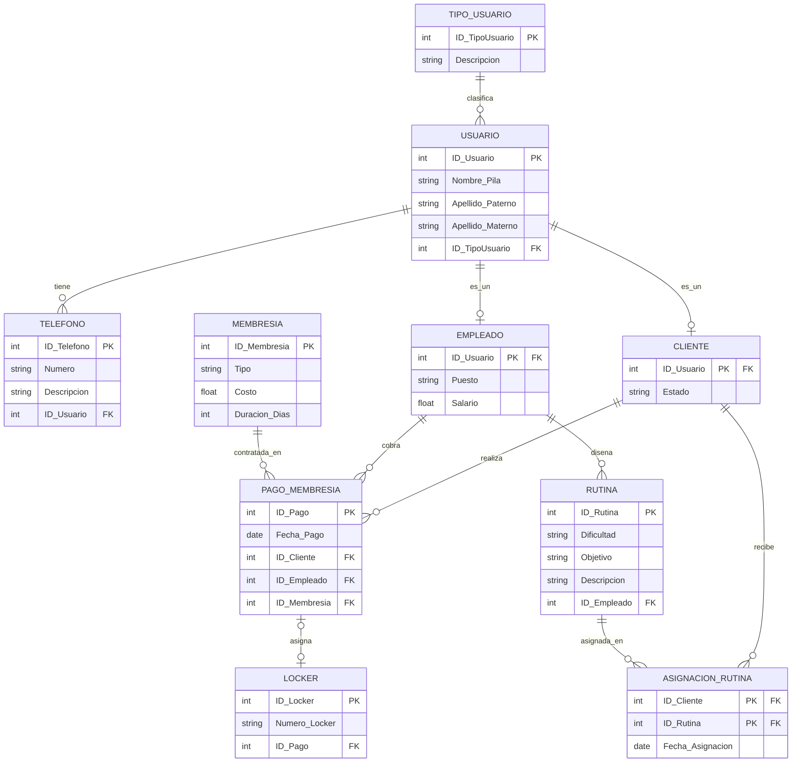

[Actividad 3.2 U_3 Fundamentos Base de datos.md]
Materia: Fundamentos Bases de Datos Actividades U.3 – Tareas 3.2 Maestro: Rubén Miguel Riojas Rodríguez Semestre: 5to Semestre Alumno: José Luis Luna García Matricula: I24050385 

### Contenido 

| Contenido  |  |
| --- | ---: |
| [**Unidad 3 - Tareas 3.2**](#unidad-3---tareas-32) | [3](#unidad-3---tareas-32) |
| [Generación del esquema físico en SGBD y script LDD](#generación-del-esquema-físico-en-sgbd-y-script-ldd) | [3](#generación-del-esquema-físico-en-sgbd-y-script-ldd) |
| [Introducción y Alcance del Esquema Físico](#introducción-y-alcance-del-esquema-físico) | [3](#introducción-y-alcance-del-esquema-físico) |
| [Diagrama del Esquema Físico Relacional](#diagrama-del-esquema-físico-relacional) | [4](#diagrama-del-esquema-físico-relacional) |
| [Diccionario de Datos del Repositorio Relacional](#diccionario-de-datos-del-repositorio-relacional) | [6](#diccionario-de-datos-del-repositorio-relacional) |
| [Script Formal DDL en SQL Estándar](#script-formal-ddl-en-sql-estándar) | [11](#script-formal-ddl-en-sql-estándar) |
| [Conclusiones y Validación de Integridad](#conclusiones-y-validación-de-integridad) | [14](#conclusiones-y-validación-de-integridad) |

# Unidad 3 - Tareas 3.2 

## Generación del esquema físico en SGBD y script LDD 

### Introducción y Alcance del Esquema Físico 

El presente reporte técnico documenta la formalización e implementación del esquema físico relacional para el Sistema de Gestión de Gimnasios, estructurado a partir del Modelo Entidad-Relación Extendido (EER) previo. La arquitectura de datos resuelve integralmente las operaciones críticas del centro deportivo: el registro centralizado de personal y clientes bajo jerarquía disjunta, la administración de múltiples líneas de contacto, la contratación de planes de entrenamiento mediante transacciones controladas, la asignación vigilada de casilleros físicos y el diseño de rutinas personalizadas. Este documento incluye el diagrama físico formal generado por la herramienta de modelado y el diccionario de datos detallado de las 10 tablas que conforman el repositorio relacional, verificando el cumplimiento estricto de la Tercera Forma Normal (3FN). 

### Diagrama del Esquema Físico Relacional 

A continuación se presenta el esquema relacional formal generado mediante la notación estándar de patas de gallo (Crow's Foot). En esta representación se aprecian las tablas normalizadas, las llaves primarias (PK), las llaves foráneas (FK), los tipos de datos asociados y las cardinalidades operativas que rigen el comportamiento del motor relacional. 

**Herencia Disjunta sin IDs Artificiales:** Las tablas CLIENTE y EMPLEADO reutilizan ID\_Usuario como PK y FK simultánea hacia USUARIO, garantizando una relación 1 a 0..1 sin redundancia. 

**Aplanamiento de Atributos Compuestos (1FN):** La superclase USUARIO atomiza el nombre completo en tres columnas independientes: Nombre\_Pila, Apellido\_Paterno y Apellido\_Materno. 

**Soporte a Transacciones Ternarias:** La tabla PAGO\_MEMBRESIA concentra las llaves foráneas de CLIENTE, EMPLEADO y MEMBRESIA, consolidando la operación de cobro en una sola entidad auditable. 

**Agregación de Casillero Controlada:** LOCKER incorpora la llave foránea ID\_Pago con restricción UNIQUE, asegurando que un casillero solo pertenezca a una membresía activa y pueda quedar libre con valor NULL. 

**Resolución de Cardinalidad N:M:** La asignación de rutinas de entrenamiento a socios se descompone en la tabla ASIGNACION\_RUTINA mediante una llave compuesta (ID\_Cliente, ID\_Rutina). 

### Diccionario de Datos del Repositorio Relacional 

El diccionario de datos define formalmente cada una de las 10 entidades físicas creadas en el motor de base de datos. Para cada atributo se documenta su nombre de columna, tipo de dato físico, restricciones de nulidad, rol de llave (PK / FK / UQ), valores por defecto y la descripción funcional en las operaciones del gimnasio. 

**Tabla: TIPO\_USUARIO** Descripción: Tabla de catálogo que tipifica y clasifica los roles del sistema (ej. Cliente, Instructor, Administrador, Recepcionista). 

| **Campo / Columna**  | **Tipo de Dato**  | **Nulo**  | **Llave / Constr.**  | **Default**  | **Descripción Funcional**  |
| --- | --- | --- | --- | --- | --- |
| **ID\_TipoUsuario**  | INT  | NO  | **PK**  | None  | Identificador único irrepetible del perfil de usuario.  |
| **Descripcion**  | VARCHAR(50)  | NO  | None  | None  | Nombre textual o etiqueta del rol de usuario en el sistema.  |

 **Tabla: USUARIO** 

Descripción: Superclase central que registra la información personal de cada persona registrada, aplanando el nombre compuesto. 

| **Campo / Columna**  | **Tipo de Dato**  | **Nulo**  | **Llave / Constr.**  | **Default**  | **Descripción Funcional**  |
| --- | --- | --- | --- | --- | --- |
| **ID\_Usuario**  | INT  | NO  | **PK**  | None  | Identificador unívoco global de la persona en el gimnasio.  |
| **Nombre\_Pila**  | VARCHAR(50)  | NO  | None  | None  | Primer nombre y segundo nombre de la persona.  |
| **Apellido\_Paterno**  | VARCHAR(50)  | NO  | None  | None  | Primer apellido o apellido paterno del usuario.  |
| **Apellido\_Materno**  | VARCHAR(50)  | SÍ  | None  | NULL  | Segundo apellido materno (opcional).  |
| **ID\_TipoUsuario**  | INT  | NO  | **FK**  | None  | Llave foránea referenciando a TIPO\_USUARIO(ID\_TipoUsuario).  |

**Tabla: TELEFONO** Descripción: Entidad que materializa el atributo multivalorado de teléfonos asociados a cada usuario (1:N). 

| **Campo / Columna**  | **Tipo de Dato**  | **Nulo**  | **Llave / Constr.**  | **Default**  | **Descripción Funcional**  |
| --- | --- | --- | --- | --- | --- |
| **ID\_Telefono**  | INT  | NO  | **PK**  | None  | Identificador secuencial del registro telefónico.  |
| **Numero**  | VARCHAR(20)  | NO  | None  | None  | Dígitos del teléfono (móvil, fijo o de emergencia).  |
| **Descripcion**  | VARCHAR(30)  | SÍ  | None  | NULL  | Etiqueta clasificatoria (ej. 'Móvil', 'Casa', 'Trabajo').  |
| **ID\_Usuario**  | INT  | NO  | **FK**  | None  | FK hacia USUARIO(ID\_Usuario) con cláusula ON DELETE CASCADE.  |

**Tabla: CLIENTE** Descripción: Subclase especializada que almacena los datos de los usuarios registrados en calidad de socios deportistas. 

| **Campo / Columna**  | **Tipo de Dato**  | **Nulo**  | **Llave / Constr.**  | **Default**  | **Descripción Funcional**  |
| --- | --- | --- | --- | --- | --- |
| **ID\_Usuario**  | INT  | NO  | **PK, FK**  | None  | Identificador heredado de USUARIO(ID\_Usuario). Actúa como PK y FK simultánea.  |
| **Estado**  | VARCHAR(20)  | NO  | None  | 'Activo'  | Condición operativa del socio (Activo, Inactivo, Suspendido).  |

**Tabla: EMPLEADO** Descripción: Subclase especializada que resguarda la información laboral y salarial de los instructores y personal administrativo. 

| **Campo / Columna**  | **Tipo de Dato**  | **Nulo**  | **Llave / Constr.**  | **Default**  | **Descripción Funcional**  |
| --- | --- | --- | --- | --- | --- |
| **ID\_Usuario**  | INT  | NO  | **PK, FK**  | None  | Identificador heredado de USUARIO(ID\_Usuario). Actúa como PK y FK simultánea.  |
| **Puesto**  | VARCHAR(50)  | NO  | None  | None  | Cargo o función del trabajador (ej. 'Entrenador', 'Recepcionista').  |
| **Salario**  | DECIMAL(10,2)  | NO  | CHECK  | None  | Remuneración mensual. Restricción CHECK (Salario \> 0).  |

**Tabla: MEMBRESIA** Descripción: Catálogo de planes comerciales y suscripciones ofertadas por el gimnasio. 

| **Campo / Columna**  | **Tipo de Dato**  | **Nulo**  | **Llave / Constr.**  | **Default**  | **Descripción Funcional**  |
| --- | --- | --- | --- | --- | --- |
| **ID\_Membresia**  | INT  | NO  | **PK**  | None  | Identificador único de la categoría de membresía.  |
| **Tipo**  | VARCHAR(50)  | NO  | None  | None  | Denominación del plan (ej. 'Mensual Básico', 'Anual VIP', 'Estudiantil').  |
| **Costo**  | DECIMAL(10,2)  | NO  | CHECK  | None  | Tarifa oficial en moneda nacional. CHECK (Costo \>= 0).  |
| **Duracion\_Dias**  | INT  | NO  | CHECK  | None  | Vigencia en días naturales del paquete. CHECK (Duracion\_Dias \> 0).  |

**Tabla: PAGO\_MEMBRESIA** Descripción: Transacción ternaria central que consolida el cobro, uniendo al cliente, al empleado receptor y al plan adquirido. 

| **Campo / Columna**  | **Tipo de Dato**  | **Nulo**  | **Llave / Constr.**  | **Default**  | **Descripción Funcional**  |
| --- | --- | --- | --- | --- | --- |
| **ID\_Pago**  | INT  | NO  | **PK**  | None  | Folio fiscal o identificador de recibo de cobro.  |
| **Fecha\_Pago**  | DATE  | NO  | None  | CURRENT\_DATE  | Fecha exacta en que se registró la transacción monetaria.  |
| **ID\_Cliente**  | INT  | NO  | **FK**  | None  | FK hacia CLIENTE(ID\_Usuario). Socio que efectúa el pago.  |
| **ID\_Empleado**  | INT  | NO  | **FK**  | None  | FK hacia EMPLEADO(ID\_Usuario). Personal que tramitó el cobro.  |
| **ID\_Membresia**  | INT  | NO  | **FK**  | None  | FK hacia MEMBRESIA(ID\_Membresia). Plan comercial contratado.  |

**Tabla: LOCKER** Descripción: Inventario de casilleros físicos con asignación controlada y opcional a la contratación vigente. 

| **Campo / Columna**  | **Tipo de Dato**  | **Nulo**  | **Llave / Constr.**  | **Default**  | **Descripción Funcional**  |
| --- | --- | --- | --- | --- | --- |
| **ID\_Locker**  | INT  | NO  | **PK**  | None  | Identificador numérico interno del casillero.  |
| **Numero\_Locker**  | VARCHAR(10)  | NO  | UQ  | None  | Etiqueta física visible en el casillero. Restricción UNIQUE.  |
| **ID\_Pago**  | INT  | SÍ  | **FK, UQ**  | NULL  | FK hacia PAGO\_MEMBRESIA(ID\_Pago). UNIQUE garantiza asignación 1:1. NULL = Libre.  |

**Tabla : RUTINA** Descripción: Catálogo de planes de acondicionamiento físico diseñados y supervisados por los instructores (1:N). 

| **Campo / Columna**  | **Tipo de Dato**  | **Nulo**  | **Llave / Constr.**  | **Default**  | **Descripción Funcional**  |
| --- | --- | --- | --- | --- | --- |
| **ID\_Rutina**  | INT  | NO  | **PK**  | None  | Identificador único de la rutina de ejercicio.  |
| **Dificultad**  | VARCHAR(20)  | NO  | None  | None  | Nivel técnico requerido (Principiante, Intermedio, Avanzado).  |
| **Objetivo**  | VARCHAR(100)  | NO  | None  | None  | Finalidad atlética (Hipertrofia, Pérdida de grasa, Resistencia).  |
| **Descripcion**  | TEXT  | SÍ  | None  | NULL  | Desglose de series, repeticiones, descansos y ejercicios.  |
| **ID\_Empleado**  | INT  | NO  | **FK**  | None  | FK hacia EMPLEADO(ID\_Usuario). Instructor que diseñó la rutina.  |

**Tabla: ASIGNACION\_RUTINA** Descripción: Tabla de unión que resuelve la relación N:M entre socios y rutinas personalizadas. 

| **Campo / Columna**  | **Tipo de Dato**  | **Nulo**  | **Llave / Constr.**  | **Default**  | **Descripción Funcional**  |
| --- | --- | --- | --- | --- | --- |
| **ID\_Cliente**  | INT  | NO  | **PK, FK**  | None  | FK hacia CLIENTE(ID\_Usuario). Socio al que se le prescribe la rutina.  |
| **ID\_Rutina**  | INT  | NO  | **PK, FK**  | None  | FK hacia RUTINA(ID\_Rutina). Rutina asignada al socio.  |
| **Fecha\_Asignacion**  | DATE  | NO  | None  | CURRENT\_DATE  | Fecha en que el socio inicia el programa de entrenamiento.  |

### Script Formal DDL en SQL Estándar 

El siguiente script DDL en SQL estándar (ANSI SQL) materializa la totalidad de tablas, restricciones de dominio, llaves primarias, llaves foráneas y reglas de integridad referencial requeridas. Este código ha sido estructurado en orden jerárquico de dependencias para permitir su ejecución directa sin errores en PostgreSQL, MariaDB/MySQL o SQL Server. 

-- 1. Catálogo de Tipos de Usuario CREATE TABLE TIPO\_USUARIO ( 

 ID\_TipoUsuario INT PRIMARY KEY, Descripcion VARCHAR(50) NOT NULL 

); -- 2. Superclase Usuario (Atributo Compuesto Aplanado a 1FN) CREATE TABLE USUARIO ( 

 ID\_Usuario INT PRIMARY KEY, Nombre\_Pila VARCHAR(50) NOT NULL, 

 Apellido\_Paterno VARCHAR(50) NOT NULL, Apellido\_Materno VARCHAR(50), 

 ID\_TipoUsuario INT NOT NULL, CONSTRAINT FK\_Usuario\_Tipo FOREIGN KEY (ID\_TipoUsuario) REFERENCES TIPO\_USUARIO(ID\_TipoUsuario) ); 

-- 3. Atributo Multivalorado Teléfono (1:N con Usuario) CREATE TABLE TELEFONO ( 

 ID\_Telefono INT PRIMARY KEY, Numero VARCHAR(20) NOT NULL, 

 Descripcion VARCHAR(30), ID\_Usuario INT NOT NULL, 

 CONSTRAINT FK\_Telefono\_Usuario FOREIGN KEY (ID\_Usuario) REFERENCES USUARIO(ID\_Usuario) ON DELETE CASCADE ); 

-- 4. Subclase Cliente (Herencia Disjunta: PK y FK simultánea) CREATE TABLE CLIENTE ( 

 ID\_Usuario INT PRIMARY KEY, Estado VARCHAR(20) NOT NULL DEFAULT 'Activo', CONSTRAINT FK\_Cliente\_Usuario FOREIGN KEY (ID\_Usuario) REFERENCES USUARIO(ID\_Usuario) ON DELETE CASCADE ); 

-- 5. Subclase Empleado (Herencia Disjunta con Validación CHECK) CREATE TABLE EMPLEADO ( 

 ID\_Usuario INT PRIMARY KEY, Puesto VARCHAR(50) NOT NULL, 

 Salario DECIMAL(10, 2) NOT NULL CHECK (Salario \> 0), CONSTRAINT FK\_Empleado\_Usuario FOREIGN KEY (ID\_Usuario) REFERENCES USUARIO(ID\_Usuario) ON DELETE CASCADE ); 

 -- 6. Entidad Membresía (Catálogo de Planes Comerciales) CREATE TABLE MEMBRESIA ( 

 ID\_Membresia INT PRIMARY KEY, Tipo VARCHAR(50) NOT NULL, 

 Costo DECIMAL(10, 2) NOT NULL CHECK (Costo \>= 0), Duracion\_Dias INT NOT NULL CHECK (Duracion\_Dias \> 0) ); 

 -- 7. Transacción Ternaria de Cobro / Agregación Contratación Vigente CREATE TABLE PAGO\_MEMBRESIA ( 

 ID\_Pago INT PRIMARY KEY, Fecha\_Pago DATE NOT NULL, 

 ID\_Cliente INT NOT NULL, ID\_Empleado INT NOT NULL, 

 ID\_Membresia INT NOT NULL, CONSTRAINT FK\_Pago\_Cliente FOREIGN KEY (ID\_Cliente) REFERENCES CLIENTE(ID\_Usuario), 

 CONSTRAINT FK\_Pago\_Empleado FOREIGN KEY (ID\_Empleado) REFERENCES EMPLEADO(ID\_Usuario), 

 CONSTRAINT FK\_Pago\_Membresia FOREIGN KEY (ID\_Membresia) REFERENCES MEMBRESIA(ID\_Membresia) 

); 

-- 8. Asignación de Casillero (1:1 Opcional a la Transacción con UNIQUE) CREATE TABLE LOCKER ( 

 ID\_Locker INT PRIMARY KEY, Numero\_Locker VARCHAR(10) NOT NULL UNIQUE, ID\_Pago INT UNIQUE, 

 CONSTRAINT FK\_Locker\_Pago FOREIGN KEY (ID\_Pago) REFERENCES PAGO\_MEMBRESIA(ID\_Pago) ON DELETE SET NULL 

); 

-- 9. Diseño de Rutinas (1:N desde Empleado) CREATE TABLE RUTINA ( 

 ID\_Rutina INT PRIMARY KEY, Dificultad VARCHAR(20) NOT NULL, 

 Objetivo VARCHAR(100) NOT NULL, Descripcion TEXT, 

 ID\_Empleado INT NOT NULL, CONSTRAINT FK\_Rutina\_Empleado FOREIGN KEY (ID\_Empleado) REFERENCES EMPLEADO(ID\_Usuario) 

); 

-- 10. Asignación de Rutinas a Clientes (Resolución de N:M con PK Compuesta) CREATE TABLE ASIGNACION\_RUTINA ( 

 ID\_Cliente INT NOT NULL, ID\_Rutina INT NOT NULL, 

 Fecha\_Asignacion DATE DEFAULT CURRENT\_DATE, PRIMARY KEY (ID\_Cliente, ID\_Rutina), 

 CONSTRAINT FK\_Asig\_Cliente FOREIGN KEY (ID\_Cliente) REFERENCES CLIENTE(ID\_Usuario) ON DELETE CASCADE, CONSTRAINT FK\_Asig\_Rutina FOREIGN KEY (ID\_Rutina) REFERENCES RUTINA(ID\_Rutina) ON DELETE CASCADE ); 

### Conclusiones y Validación de Integridad 

El esquema físico implementado y documentado en este reporte técnico cumple de manera estricta con los estándares de la teoría relacional y los requerimientos del caso de estudio: 

1. Normalización Completa (3FN): Todas las dependencias funcionales han sido aisladas; no existen dependencias transitivas ni parciales, y los atributos derivados como la vigencia de membresía se calculan en capa de consulta evitando anomalías de actualización. 
2. Integridad Referencial Blindada: El uso sistemático de ON DELETE CASCADE en entidades dependientes (como teléfonos y perfiles) garantiza que no existan registros huérfanos, mientras que ON DELETE SET NULL en casilleros preserva el activo físico disponible si una transacción de cobro concluye. 
3. Eficiencia en Consultas: La propagación de llaves naturales como ID\_Usuario en CLIENTE y EMPLEADO simplifica las operaciones JOIN, minimizando el costo computacional de indexación en el SGBD y garantizando un rendimiento óptimo en ambientes de producción. 
